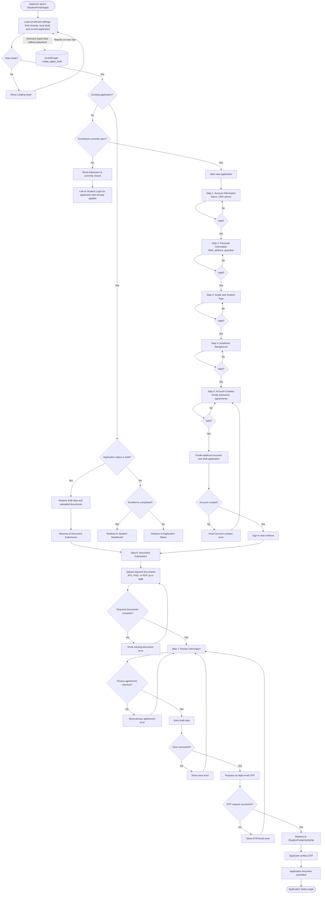

# Online Admission Flowchart

This flowchart describes the applicant flow implemented in `src/components/pages/StudentPortal/Apply.jsx`.

## Main Actors

- **Applicant:** completes the online admission wizard, uploads documents, and verifies the application by email OTP.
- **Admin:** controls whether online admission is open, the active school year, season dates, and the closed-admission message.
- **Registrar:** reviews submitted applications after OTP verification.

## Important Gate

A new applicant is blocked when `isEnrollmentOpen(enrollment)` returns `false`. An applicant with an existing draft is allowed to resume the draft and continue to document submission even when new admission is closed.
