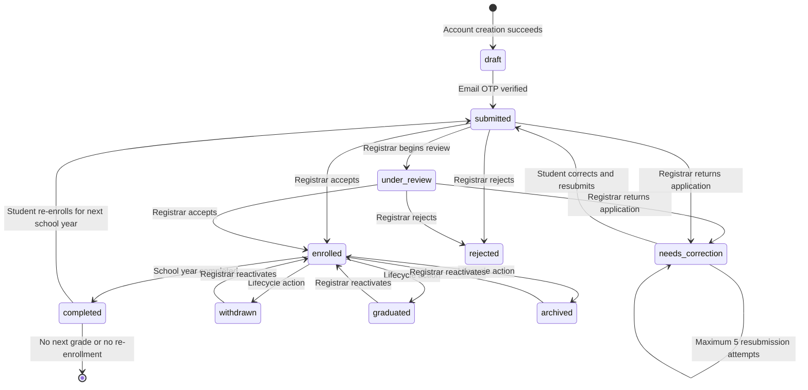

# NSDGA Student Lifecycle Flow

This diagram describes the complete student journey implemented by the portal: public application, applicant-only access, enrollment review, enrolled-student access, and continuing-student re-enrollment.

## Complete Student Flow

```mermaid
flowchart TD
    START([Student or parent opens NSDGA website]) --> HOME[Public website]
    HOME --> APPLY[/StudentPortal/Apply]
    HOME --> LOGIN[/StudentPortal/Login]

    %% ------------------------------------------------------------
    %% APPLICATION CREATION
    %% ------------------------------------------------------------
    subgraph APPLY_FLOW[1. Student Apply Flow]
        APPLY --> LOAD[Load enrollment settings, active school year, SHS strands, local draft, and current application]
        LOAD --> READY{Data ready?}
        READY -- No --> LOADING[Show loading state]
        LOADING --> LOAD
        READY -- Yes --> EXISTING{Existing application found?}

        EXISTING -- Yes --> DRAFT_CHECK{Application status is draft?}
        DRAFT_CHECK -- Yes --> RESTORE[Restore saved form and continue at Document Submission]
        RESTORE --> DOCS
        DRAFT_CHECK -- No --> PRIOR_STATUS{Current application status}
        PRIOR_STATUS -- Enrolled or completed --> STUDENT_DASH[Redirect to Student Dashboard]
        PRIOR_STATUS -- Any applicant status --> APP_STATUS[Redirect to Application Status]

        EXISTING -- No --> OPEN{Enrollment period open?}
        OPEN -- No --> CLOSED[Show admission closed message]
        CLOSED --> LOGIN
        OPEN -- Yes --> STEP1

        STEP1[Step 1: Account Information\nName, LRN, mobile number] --> V1{Valid?}
        V1 -- No --> STEP1_ERROR[Show field errors] --> STEP1
        V1 -- Yes --> SAVE1[Save draft locally] --> STEP2

        STEP2[Step 2: Personal Information\nSex, DOB, birthplace, address, parent or guardian] --> V2{Valid?}
        V2 -- No --> STEP2_ERROR[Show field errors] --> STEP2
        V2 -- Yes --> SAVE2[Save draft locally] --> STEP3

        STEP3[Step 3: Grade and Student Type\nLevel, grade, new/transferee/returnee, SHS strand] --> V3{Valid?}
        V3 -- No --> STEP3_ERROR[Show field errors\nSHS requires strand] --> STEP3
        V3 -- Yes --> SAVE3[Save draft locally] --> STEP4

        STEP4[Step 4: Academic Background\nPrevious school, school address, GWA, last grade] --> V4{Valid?}
        V4 -- No --> STEP4_ERROR[Show field errors\nGrade 1 has reduced academic requirements] --> STEP4
        V4 -- Yes --> SAVE4[Save draft locally] --> STEP5

        STEP5[Step 5: Account Creation\nEmail, password, confirmation, agreements] --> V5{Valid?}
        V5 -- No --> STEP5_ERROR[Show account or password errors] --> STEP5
        V5 -- Yes --> CAPTCHA[Cloudflare Turnstile token]
        CAPTCHA --> CREATE[Call Supabase create-applicant Edge Function]
        CREATE --> CREATE_RESULT{Account and draft created?}
        CREATE_RESULT -- No --> CREATE_ERROR[Show creation error\nRemain on Account Creation] --> STEP5
        CREATE_RESULT -- Yes --> AUTH[Supabase Auth signs student in]
        AUTH --> DOCS

        DOCS[Step 6: Document Submission] --> FILE_RULES{File valid?}
        FILE_RULES -- No --> FILE_ERROR[Reject file\nJPG, PNG, PDF only\nMaximum 5 MB] --> DOCS
        FILE_RULES -- Yes --> STORAGE[Upload to private student-docs storage\nRecord path, filename, size, timestamp, status]
        STORAGE --> DOC_COMPLETE{Required documents complete?}
        DOC_COMPLETE -- No --> MISSING[Show missing-document message] --> DOCS
        DOC_COMPLETE -- Yes --> REVIEW

        REVIEW[Step 7: Review Information\nReview form, documents, and privacy agreement] --> PRIVACY{Privacy agreement checked?}
        PRIVACY -- No --> PRIVACY_ERROR[Show agreement error] --> REVIEW
        PRIVACY -- Yes --> SAVE_DB[Save application draft and form data]
        SAVE_DB --> OTP_REQUEST[Call send-otp Edge Function]
        OTP_REQUEST --> OTP_SENT{OTP sent?}
        OTP_SENT -- No --> OTP_ERROR[Show email or OTP error] --> REVIEW
        OTP_SENT -- Yes --> VERIFY[/StudentPortal/VerifyOtp]
        VERIFY --> OTP_INPUT[Student enters six-digit email OTP]
        OTP_INPUT --> OTP_VALID{OTP valid, unexpired, under attempt limit?}
        OTP_VALID -- No --> OTP_FAIL[Reject code\nMaximum 5 attempts\n10-minute expiry] --> OTP_INPUT
        OTP_VALID -- Yes --> SUBMITTED[Application status becomes submitted]
    end

    SUBMITTED --> APP_STATUS

    %% ------------------------------------------------------------
    %% APPLICANT STATE
    %% ------------------------------------------------------------
    subgraph APPLICANT_FLOW[2. Student Applicant Flow - Not Yet Enrolled]
        APP_STATUS[Application Status page] --> APP_LOGIN{Signed in as student?}
        APP_LOGIN -- No --> LOGIN
        APP_LOGIN -- Yes --> APPLICANT_MENU[Applicant Portal sidebar:\nApplication Status\nEnrollment Form]

        APPLICANT_MENU --> TRACK[View application ID, grade, student type, school year, status tracker, and Registrar note]
        APPLICANT_MENU --> FORM[Open Enrollment Form]

        FORM --> FORM_STATUS{Current application status}
        FORM_STATUS -- draft --> EDIT_DRAFT[Edit form and documents]
        FORM_STATUS -- submitted or under_review --> READ_ONLY[Read-only while Registrar reviews]
        FORM_STATUS -- needs_correction --> EDIT_CORRECTION[Edit returned form and documents]
        FORM_STATUS -- rejected or final state --> LOCKED[Record locked for editing]

        EDIT_DRAFT --> SAVE_DRAFT[Save draft without changing status]
        SAVE_DRAFT --> FORM

        EDIT_CORRECTION --> CORRECTION_VALID{Required corrections valid?}
        CORRECTION_VALID -- No --> CORRECTION_ERROR[Show validation error] --> EDIT_CORRECTION
        CORRECTION_VALID -- Yes --> CERTIFY{Applicant certifies changes?}
        CERTIFY -- No --> CERTIFY_ERROR[Show certification error] --> EDIT_CORRECTION
        CERTIFY -- Yes --> RESUBMIT_LIMIT{Fewer than 5 resubmissions?}
        RESUBMIT_LIMIT -- No --> CONTACT_REGISTRAR[Show limit reached\nContact Registrar]
        RESUBMIT_LIMIT -- Yes --> RESUBMIT[Status returns to submitted\nResubmission count increases]
        RESUBMIT --> APP_STATUS

        TRACK --> REVIEW_STATE{Registrar decision}
        REVIEW_STATE -- Under review --> WAIT[Wait for review\nNo editing unless returned]
        WAIT --> APP_STATUS
        REVIEW_STATE -- Needs correction --> EDIT_CORRECTION
        REVIEW_STATE -- Rejected --> REJECTED[Show rejected status and Registrar note]
        REVIEW_STATE -- Enrolled --> ENROLLMENT_RESULT[Show student number and unlock full portal]
    end

    %% ------------------------------------------------------------
    %% REGISTRAR DECISION
    %% ------------------------------------------------------------
    SUBMITTED --> REGISTRAR[Registrar receives submitted application]
    REGISTRAR --> REVIEW_DECISION{Registrar reviews form and documents}
    REVIEW_DECISION -- Needs correction --> RETURNED[Set status needs_correction\nSave review note]
    RETURNED --> APP_STATUS
    REVIEW_DECISION -- Reject --> REJECTED_DB[Set status rejected\nSave review note]
    REJECTED_DB --> APP_STATUS
    REVIEW_DECISION -- Accept and enroll --> ENROLL[Set status enrolled\nAssign unique student number\nSave review metadata]
    ENROLL --> ENROLLMENT_RESULT
    ENROLL --> NOTIFY[Send enrollment notification through notify Edge Function]

    %% ------------------------------------------------------------
    %% ENROLLED STUDENT
    %% ------------------------------------------------------------
    subgraph ENROLLED_FLOW[3. Enrolled Student Flow]
        ENROLLMENT_RESULT --> FULL_ACCESS[Student becomes enrolled]
        FULL_ACCESS --> FULL_MENU[Full Student Portal sidebar:\nDashboard\nApplication Status\nEnrollment Form\nDocuments\nNotifications\nMy Profile\nSettings]

        FULL_MENU --> DASHBOARD[Student Dashboard]
        FULL_MENU --> FULL_STATUS[Application Status with student number]
        FULL_MENU --> ENROLL_FORM_LOCKED[Enrollment Form for current record]
        FULL_MENU --> STUDENT_DOCS[Documents page\nView own documents with signed URLs]
        FULL_MENU --> NOTIFICATIONS[Notifications page]
        FULL_MENU --> PROFILE[My Profile page]
        FULL_MENU --> SETTINGS[Settings\nChange password\nOptional MFA]

        DASHBOARD --> CURRENT_RECORD[View current grade, section, school year, status, announcements, and history]
        CURRENT_RECORD --> YEAR_STATUS{Current school-year status}
        YEAR_STATUS -- enrolled --> CONTINUE[Continue using full portal]
        YEAR_STATUS -- completed --> REENROLL_CHECK{Next grade and enrollment season available?}
        YEAR_STATUS -- withdrawn/graduated/archived --> DEPROVISIONED[Account access becomes inactive]

        REENROLL_CHECK -- No --> WAIT_SEASON[Show next enrollment season message]
        REENROLL_CHECK -- Yes --> NEXT_GRADE[Choose next grade\nChoose SHS strand if entering Grade 11]
        NEXT_GRADE --> REENROLL[Create new submitted application for next school year]
        REENROLL --> CONTINUING_REVIEW[Continuing student keeps full portal access\nwhile new application is reviewed]
        CONTINUING_REVIEW --> NEW_YEAR_STATUS{Registrar reviews new-year application}
        NEW_YEAR_STATUS -- Needs correction --> CONTINUING_EDIT[Edit and resubmit new-year application]
        CONTINUING_EDIT --> CONTINUING_REVIEW
        NEW_YEAR_STATUS -- Enrolled --> CONTINUE
        NEW_YEAR_STATUS -- Rejected --> CONTINUE
    end

    %% ------------------------------------------------------------
    %% AUTHENTICATION AND ACCESS FAILURES
    %% ------------------------------------------------------------
    LOGIN --> CREDENTIALS[Supabase Auth validates email and password]
    CREDENTIALS --> AUTH_RESULT{Credentials valid?}
    AUTH_RESULT -- No --> LOGIN_ERROR[Show generic invalid credentials error] --> LOGIN
    AUTH_RESULT -- Yes --> PROFILE_CHECK[Load student profile and latest application]
    PROFILE_CHECK --> ROLE_CHECK{Role is student and account enabled?}
    ROLE_CHECK -- No --> ACCESS_DENIED[Sign out and deny student portal access]
    ROLE_CHECK -- Yes --> MFA_CHECK{MFA factor enrolled?}
    MFA_CHECK -- No --> SESSION[Create normal student session]
    MFA_CHECK -- Yes --> MFA_CODE[Require Supabase TOTP code]
    MFA_CODE --> MFA_VALID{Code valid?}
    MFA_VALID -- No --> MFA_ERROR[Reject code] --> MFA_CODE
    MFA_VALID -- Yes --> AAL2[Session reaches MFA-verified assurance level]
    SESSION --> DESTINATION{Latest application state}
    AAL2 --> DESTINATION
    DESTINATION -- Applicant --> APP_STATUS
    DESTINATION -- Enrolled --> STUDENT_DASH
    DESTINATION -- No application --> APPLY
    DESTINATION -- Deprovisioned --> ACCESS_DENIED

    %% ------------------------------------------------------------
    %% LOCAL DRAFT
    %% ------------------------------------------------------------
    DRAFT_CACHE[(Local draft storage\nForm data only\nPassword never stored\nExpires after approximately 12 hours)]
    STEP1 -. autosave .-> DRAFT_CACHE
    STEP2 -. autosave .-> DRAFT_CACHE
    STEP3 -. autosave .-> DRAFT_CACHE
    STEP4 -. autosave .-> DRAFT_CACHE
    DRAFT_CACHE -. restore on return .-> LOAD
```

## Student Access Matrix

| Area | Public visitor | Applicant / not enrolled | Enrolled student | Continuing student under re-enrollment review |
|---|---:|---:|---:|---:|
| Home and public pages | Yes | Yes | Yes | Yes |
| Apply page | Yes | Yes, subject to enrollment period | Redirects to portal/status as appropriate | Existing application is handled through portal |
| Student login | Yes | Yes | Yes | Yes |
| Application Status | No account required to view shell | Yes | Yes | Yes |
| Enrollment Form | No | Yes | Yes, current record rules apply | Yes for the new-year record when editable |
| Student Dashboard | No | No | Yes | Yes, retained because prior record was enrolled/completed |
| Documents | No | No | Yes | Yes |
| Notifications | No | No | Yes | Yes |
| My Profile | No | No | Yes | Yes |
| Settings | No | No | Yes | Yes |
| Staff or admin pages | No | No | No | No |

## Application Status State Model



## Backend Touchpoints

| Flow step | Main implementation | Backend operation |
|---|---|---|
| Load application | `src/lib/student.js` | Read current student's application through Supabase |
| Enrollment availability | `src/lib/content.js` | Read `site_content.enrollment` |
| SHS strands | `src/lib/content.js` | Read Admin-managed `site_content.strands` |
| Applicant account creation | `supabase/functions/create-applicant/index.ts` | Supabase Auth admin creation plus draft application insert |
| Bot protection | `src/components/Turnstile.jsx` and `create-applicant` | Cloudflare Turnstile token verification |
| Email verification | `send-otp` and `verify-otp` Edge Functions | Hashed OTP, expiry, attempt limit, application submission |
| Document upload | `src/lib/student.js` | Private Supabase Storage upload and application document metadata |
| Application review | `src/lib/registrar.js` | Registrar updates status through Supabase RLS-protected tables |
| Enrollment | `src/lib/registrar.js` | Set `enrolled`, assign student number, record review fields |
| Notifications | `supabase/functions/notify/index.ts` | Brevo transactional email through Supabase Edge Function |
| Student login | `src/lib/student.js` | Supabase Auth password login and profile/application checks |
| MFA | `src/auth/authStore.js` | Supabase Auth TOTP enrollment, challenge, verification, and removal |
| Applicant route access | `src/App.jsx` and `src/auth/ProtectedRoute.jsx` | Student login gate; applicant pages require login only |
| Full portal access | `src/App.jsx` and `ProtectedRoute` | `requireEnrolled` gate plus continuing-student history exception |
| Re-enrollment | `src/lib/student.js` | Insert next-year `submitted` application |

## Rules To Preserve In The Diagram

- A new application is blocked when enrollment is closed, but an existing draft can be resumed.
- The applicant account is created before document upload because uploads require an authenticated Supabase session.
- Form 137 is not uploaded by the student; it is transferred school-to-school.
- Required application documents are the 2x2 picture, report card, and PSA birth certificate. Good Moral is collected by the current form flow; Grade 1 may have additional kindergarten documentation.
- Email OTP verification changes a draft application to `submitted`.
- `submitted` and `under_review` applications are not editable by the applicant.
- `needs_correction` allows editing and resubmission, subject to the five-resubmission limit.
- `rejected` applications remain visible with the Registrar's note but are locked.
- `enrolled` gives the student a student number and unlocks the full portal.
- A continuing student with an earlier `enrolled` or `completed` record keeps full portal access while a new-year application is under review.
- Withdrawn, graduated, and archived students are deprovisioned from login until reactivated.
- MFA is Supabase Auth TOTP. React supplies the screens; Supabase validates the factor and session assurance.
