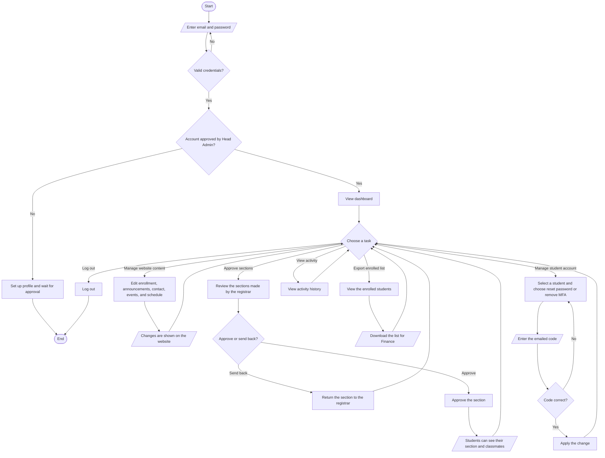

# Admin Module — System Flowchart and Description

---

**Figure 3.2. System Flowchart of the Admin Module**

The figure above presents the flow of the admin module of the system developed by the researchers. The process begins when the administrator opens the system and is asked to enter a valid email and password. The system then checks whether the credentials entered are correct. If the credentials are not valid, the administrator is brought back to the login page to try again. If the credentials are valid, the system checks whether the administrator's account has already been approved by the head administrator. If the account is not yet approved, the administrator is first asked to set up a profile and to wait for approval before the system can be used. If the account is already approved, the administrator is directed to the dashboard.

From the dashboard, the administrator is able to choose a task to perform. The main task of the administrator is to manage the content of the school website, such as the enrollment and announcements, the contact information, the school events, the executive board, and the academic schedule. Whatever the administrator edits and saves is then shown on the public website that the visitors and students can see. Another task of the administrator is to approve the sections that were created by the registrar. When the administrator reviews a section, the system asks whether to approve it or to send it back. If the section is sent back, it is returned to the registrar for changes. If the section is approved, the students assigned to that section are able to see their section and their list of classmates.

The administrator may also prepare the record of enrolled students for the finance office. In this task, the administrator views the list of enrolled students for the active school year and downloads the list so that the finance office can handle the payment on their side. Aside from this, the administrator is allowed to manage a student's account when a student is locked out. In this process, the administrator selects a student and chooses either to reset the password or to remove the multi-factor authentication. For security, the system sends a code to the administrator's email, and the system checks whether the entered code is correct. If the code is not correct, the administrator is asked to try again. If the code is correct, the change is applied to the student's account.

Finally, the administrator may view a history of the actions that have already been made, and when all the needed tasks are done, the administrator may log out of the system, which ends the process. Through this flow, the proponents made sure that the administrator has full control over the website content and the section approvals, while sensitive actions such as changing a student's account are protected by an additional code before they are allowed.
