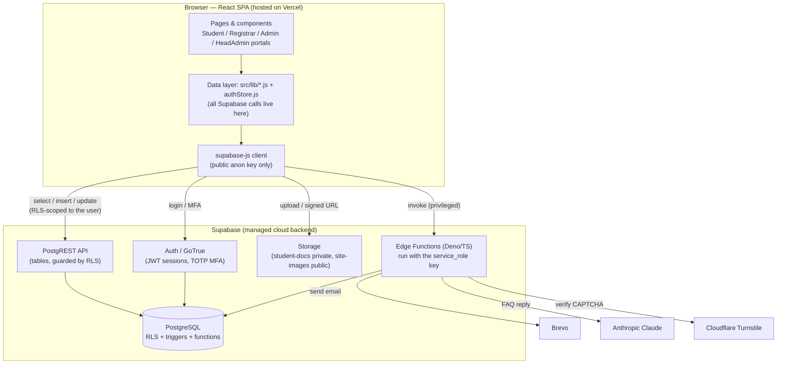
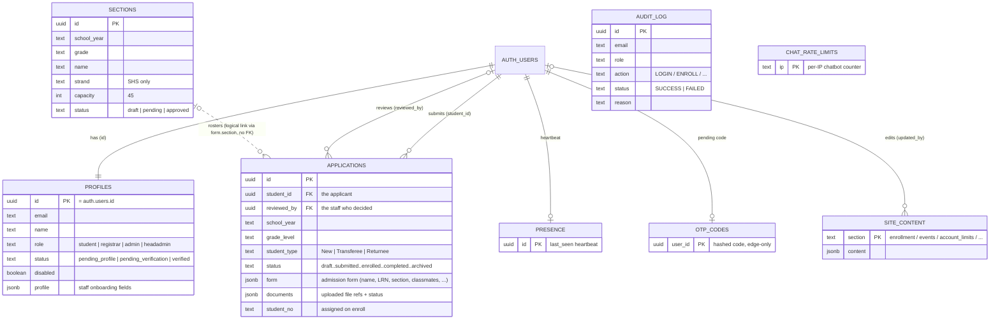
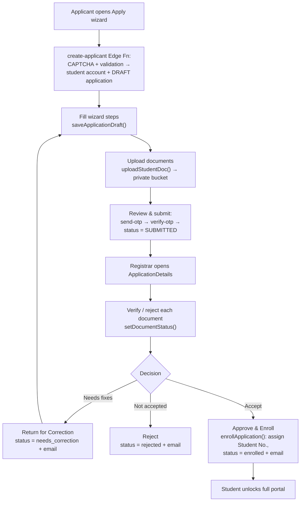
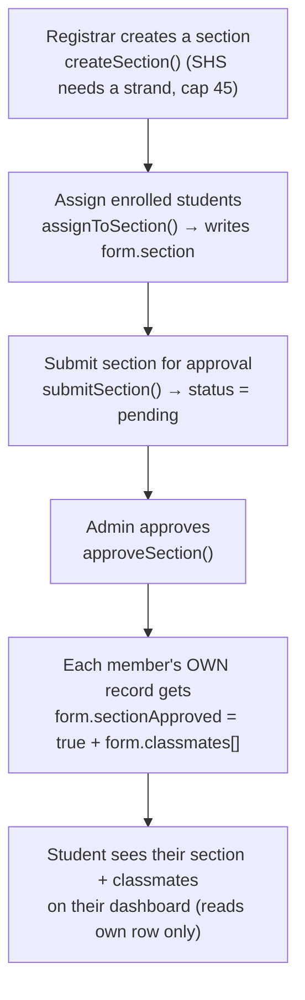
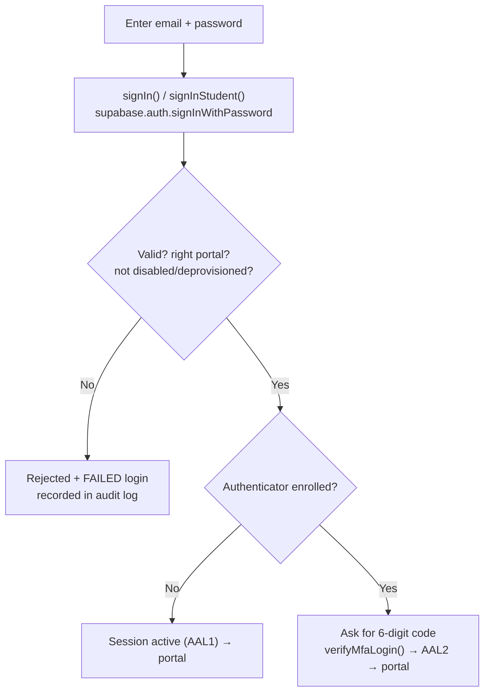
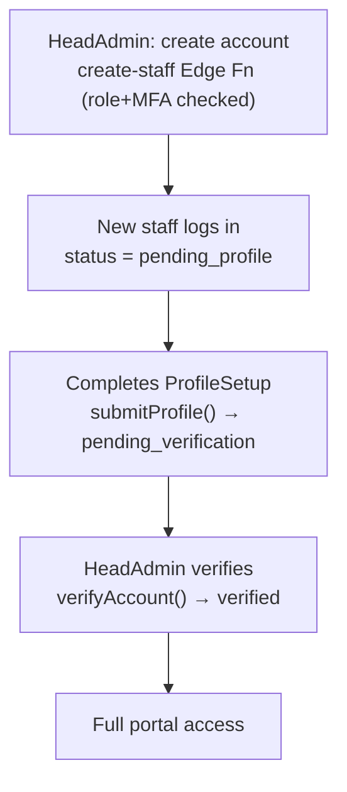
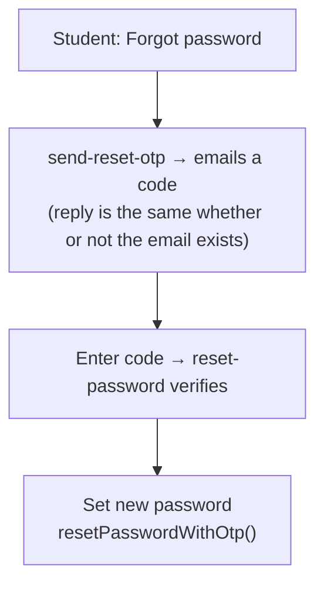

# NSDGA Online Enrollment — Defense Study Guide (Reviewer)

> Read this in one sitting before the panel. It explains the whole system in plain
> language, grounded in the **actual code**. Where something is **not** in the code
> (e.g. a formal methodology write-up), it says so and tells you how to answer
> honestly. Companion file: **`DEFENSE_QUESTIONS.md`** (100+ Q&A).

**One-line description:** A web-based **online admission & enrollment portal** for
Nuestra Señora de Guia Academy of Marikina (NSDGA), built with **React + Vite** on
the front end and **Supabase** (Postgres + Auth + Storage + serverless functions)
on the back end.

> **Important honesty note about scope.** The brief calls this a "Registrar Portal
> with a Student side and a Registrar side." That is the heart of the system, but
> the code actually has **four roles / portals**: **Student**, **Registrar**,
> **Admin** (website content + approvals + finance export + student-account
> recovery), and **HeadAdmin** (staff accounts + audit log + reports). This guide
> focuses on Student and Registrar as asked, but be ready to mention Admin and
> HeadAdmin — the panel may click into them. Don't claim the system is only two
> sides; say "the two main sides are Student and Registrar, plus two admin roles."

---

## 1. System overview (plain language)

### The problem
Enrolling at NSDGA used to mean going to the campus, filling paper forms, and
waiting in line. That is slow for parents, and it gives the registrar a pile of
paper to sort, with no easy way to track each applicant's status or keep a clean
history year to year.

### What the system does
It moves admission online. An applicant creates an account, fills an admission
form, uploads their requirements, and submits. The **registrar** reviews each
application, verifies the uploaded documents, and either returns it for
corrections, rejects it, or **approves and enrolls** the student (which assigns a
Student Number). After enrollment, the registrar builds **class sections**, the
**admin** approves them, and the student can then see their section and
classmates. The system keeps a full record per student per school year, so
**re-enrollment** the next year is easy and history is preserved under one Student
Number.

### Users (roles)
| Role | Who | Main job |
|---|---|---|
| **Student / Applicant** | the learner or parent | Apply, upload documents, track status; once enrolled, view record, section, classmates |
| **Registrar** | admissions staff | Review applications, verify documents, enroll/return/reject, build sections, manage student lifecycle |
| **Admin** | website/content staff | Manage public website content, set the active school year, approve sections, export the finance list, recover student accounts |
| **HeadAdmin** | top administrator | Create/verify staff accounts, change roles, read the audit log and reports |

### Objectives (what success looks like)
- Let applicants apply and track status **online**, any time.
- Give the registrar **one place** to review, decide, and enroll, with document checking.
- Keep a **secure, per-year record** per student so re-enrollment and history are easy.
- Enforce a strict boundary so a student can **only** see and change their own data.
- Give administrators tools for **sections, website content, reports, and account recovery**.

### Scope (what's in)
Online application wizard, document upload, email-OTP verification, registrar
review + enrollment, document verification, class sectioning + admin approval,
student lifecycle (complete year / graduate / withdraw / archive / reactivate /
re-admit), re-enrollment, public website content management, academic calendar,
finance **export** (CSV), account management (create staff, verify, roles, reset
password, remove MFA, account limits), an audit log, reports, and an FAQ chatbot.

### Limitations (what's intentionally out — be honest, these are in the code)
- **No online payment.** Finance is a **read-only CSV export** (`src/lib/billing.js`); the school's finance office does assessment/collection in its own system. The app never stores payments.
- **Kindergarten admission is face-to-face**, not online (`ALL_GRADES` in `src/lib/grades.js` excludes Kinder).
- **Form 137 is never uploaded** — it is a confidential record transmitted school-to-school (`REQUIRED_DOCS` comment in `src/lib/student.js`).
- **Depends on third-party free tiers** — email is Brevo (≈300/day), the chatbot is a paid Anthropic API with a small balance.
- **Backend changes (SQL + Edge Functions) are deployed by hand** in the Supabase dashboard; only the front end auto-deploys (Vercel).
- **MFA is currently not enforced** for any role (the capability is fully built, but `MFA_REQUIRED_ROLES = []` in `src/auth/authStore.js`). Say this plainly if asked.
- **English-only UI**, **responsive web only** (no native mobile app), requires an internet connection.

---

## 2. Technology stack and WHY (with alternatives)

Versions are from `package.json`.

| Layer | We used | Why | Alternatives we could have used |
|---|---|---|---|
| **UI framework** | **React 19** | Component-based, huge ecosystem, the team already knew it; builds a single-page app (SPA) | Vue, Angular, Svelte |
| **Build tool / dev server** | **Vite 8** | Extremely fast dev server (instant hot reload) and an optimized production build; simpler than older bundlers | Create-React-App (deprecated), Webpack, Parcel |
| **Routing** | **React Router 7** (lazy routes) | Standard client-side routing; we **code-split** each page so it loads on demand (smaller first load) | TanStack Router, Next.js file routing |
| **Styling** | **Tailwind CSS v4 + daisyUI 5** | Utility-first styling = consistent design fast, no large custom CSS files; daisyUI gives ready components | Plain CSS/SCSS, Bootstrap, Material UI |
| **Icons** | **react-icons 5** | One package, thousands of icons | SVG files by hand, Font Awesome |
| **Backend (BaaS)** | **Supabase** | Postgres database + Auth + file Storage + serverless Edge Functions in **one managed service** — no server for us to run, patch, or scale | Firebase, custom Node/Express + PostgreSQL, Laravel, ASP.NET |
| **Database** | **PostgreSQL + Row-Level Security (RLS)** | A real relational DB; **RLS lets the database itself decide which rows each user may touch** — security that can't be bypassed from the browser | MySQL, MongoDB, Firebase Firestore |
| **Authentication** | **Supabase Auth (GoTrue)** | Email/password login, JWT sessions, built-in TOTP MFA; saved us from writing auth from scratch | Firebase Auth, Auth0, hand-rolled JWT |
| **Serverless logic** | **Supabase Edge Functions (Deno/TypeScript)** | For privileged work that must run on the server (create users, send email, call paid APIs, verify OTP) using the secret key the browser must never see | AWS Lambda, Node/Express server, Next.js API routes |
| **Email** | **Brevo** | Simple transactional email API, free tier for a school-size load | SendGrid, Mailgun, Gmail SMTP |
| **AI chatbot** | **Anthropic Claude (Haiku)** | A small, cheap, fast model for a grounded admission-FAQ assistant | OpenAI GPT, a scripted FAQ with no AI |
| **Bot protection** | **Cloudflare Turnstile** | Free CAPTCHA to stop bots from mass-creating accounts | Google reCAPTCHA, hCaptcha |
| **Address data** | **PSGC dataset** | Official Philippine Region→Province→City→Barangay list for cascading dropdowns | Free-text address field, Google Places API |
| **Hosting** | **Vercel** | Free, fast static hosting; **auto-deploys on every `git push` to `main`** | Netlify, GitHub Pages, Firebase Hosting |

**The single most important design idea:** the browser only ever holds the
**public anon key**. It talks to the database directly, but **RLS decides what it
can see or change**. Anything powerful (the `service_role` key, the Anthropic and
Brevo keys) lives **only inside Edge Functions**, never in the browser bundle.

---

## 3. System architecture

A **three-tier** design: (1) the React SPA in the browser, (2) Supabase as the
managed backend (database, auth, storage, functions), (3) external services the
functions call.

**How a normal read flows** (student views their application):
1. React calls `supabase.from('applications').select('*')` carrying the user's JWT.
2. PostgREST runs it, but the **RLS policy rewrites** it to `... where student_id = auth.uid()` — the student only gets their own rows.
3. Data returns and renders.

**How a privileged action flows** (HeadAdmin creates a registrar):
1. React calls `supabase.functions.invoke('create-staff', { body })`.
2. The Edge Function checks the caller is a HeadAdmin (and MFA), then uses the **service_role** key to create the account — something the browser can never do directly.

---

## 4. Modules / features — by side

> Pattern used everywhere: **components never write raw queries.** They call
> helper functions in `src/lib/*.js` and `src/auth/authStore.js`, which wrap the
> Supabase calls. That keeps the "backend contract" in one place.

### 4.1 STUDENT side — `src/components/pages/StudentPortal/`

| Feature | What it does | Key files | How it works (steps) |
|---|---|---|---|
| **Apply (wizard)** | Multi-step admission application | `StudentPortal/Apply.jsx`, `src/lib/student.js`, Edge `create-applicant` | Account step → `createApplicantAccount()` calls `create-applicant` (CAPTCHA + validation) which makes a **student** account + a **draft** application, then signs them in. Next steps save via `saveApplicationDraft()`. Documents upload to the private bucket. Review & submit → `requestSignupOtp()` emails a 6-digit code → `verifySignupOtp()` flips the draft to **submitted**. |
| **Dashboard / Application Status** | Shows status, student number, progress, announcements, re-upload alerts | `StudentPortal/Dashboard.jsx`, `ApplicationStatus.jsx` | Reads `getMyApplication()`; shows the lifecycle (`APP_STEPS`, `STATUS_LABEL` in `student.js`). Full portal unlocks only when enrolled (`isEnrolled` in `SessionProvider.jsx`). |
| **Enrollment Form** | Edit + resubmit when returned for corrections | `StudentPortal/EnrollmentForm.jsx`, `resubmitApplication()` | When status is `needs_correction`, the form becomes editable; resubmit sets status back to `submitted`. Unlimited resubmits, but **throttled server-side** (1/min) by a DB trigger. |
| **Documents** | Upload / re-upload, see per-document status | `StudentPortal/Documents.jsx`, `uploadStudentDoc()`, `signedDocUrl()` | Files go to `student-docs/{user_id}/{docKey}.{ext}` with **upsert** (re-upload overwrites). Viewing uses a **5-minute signed URL**. Required docs: 2x2 photo, Report Card (Form 138), PSA, Good Moral. |
| **Re-enrollment** | File next year's record for the next grade | `reEnroll()` in `student.js`, `src/lib/grades.js` | Creates a **new** application row for the next grade + next school year (`nextGrade`, `nextSchoolYear`); SHS requires a strand. History stays under the same Student Number. |
| **Notifications / My Activity / Profile / Settings** | Alerts, own action history, edit contact info, change password + MFA | `Notification.jsx`, `Activity.jsx`, `Profile.jsx`, `Setting.jsx`, `MyActivity.jsx` | Settings uses `changePassword()` and the MFA enroll/disable functions in `authStore.js`. |

### 4.2 REGISTRAR side — `src/components/pages/RegistrarPortal/`

| Feature | What it does | Key files | How it works (steps) |
|---|---|---|---|
| **Dashboard** | Counts + newest applications | `RegistrarPortal/Dashboard.jsx`, `listApplications()` | Reads all applications (RLS lets verified staff read all); scopes counts to the active school year. |
| **Applications list + Application Details** | Review one application, verify documents, decide | `Applications.jsx`, `ApplicationDetails.jsx`, `registrar.js` | Opens documents via signed URLs; per document **Verify/Reject** (`setDocumentStatus`); decision: **Mark Under Review** (`setUnderReview`), **Return for Correction** (`returnForCorrection`), **Reject** (`rejectApplication`), or **Approve & Enroll** (`enrollApplication`). |
| **Enroll** | Accept + assign a Student Number | `enrollApplication()` | Computes the next number (e.g. `2026-0001`) via `nextStudentNo()`; returnees keep their original number; a **UNIQUE index + retry** stops duplicates; a **status-gated update** stops two registrars double-handling the same applicant (`ACTIONABLE` set). Emails the student via `notify`. |
| **Documents triage** | Sort applicants by document completeness | `RegistrarPortal/Documents.jsx` | Reads the `documents` JSON per application. |
| **Student Records / Student Profile** | Full per-student history + lifecycle | `StudentRecords.jsx`, `StudentProfile.jsx` | `getStudentRecord()` lists every yearly record; lifecycle actions: `markCompleted`, `setLifecycle` (withdraw/graduate/archive), `reactivateStudent`, `readmitStudent`, `bulkArchive`. Deprovisioned students can't log in (checked in `signInStudent`). |
| **Sections** | Create/rename/delete, assign students, submit for approval | `RegistrarPortal/Sections.jsx`, `registrar.js` | `createSection` (SHS needs a strand, 45 cap), `assignToSection` (cap enforced; editing a roster reverts it to `draft`), `submitSection` → status `pending` for Admin. |
| **History** | The registrar's own action feed | `RegistrarPortal/History.jsx`, `listMyActivity()`, `MyActivity.jsx` | Reads the audit log filtered to their own email, hiding login/logout rows. |

### 4.3 ADMIN & HEADADMIN (be ready to mention)
- **Admin** (`AdminPortal/`): website content (Enrollment & Announcements incl. **active school year** + section caps, Contact, School Events, Executive Board, Academic Schedule, SHS Courses), **Section Approvals** (`approveSection` releases each student's section + classmates), **Finance Export** (CSV, `billing.js`), **Manage Student** (reset password / remove MFA for a student, OTP-confirmed).
- **HeadAdmin** (`HeadAdminPortal/`): **Accounts** (create staff, verify, enable/disable, change role with OTP, reset staff password/MFA, set per-role **account limits**), **Audit Log** (every login + action, MFA brute-force alerts), **Reports & Analytics**, **System Usage**.

---

## 5. Data model (tables, key fields, relationships)

Everything hangs off Supabase's built-in `auth.users`. Application data lives in
the `public` schema. **Flexible data is stored as `jsonb`** (`form`, `documents`,
`billing`, `profile`, `content`) so the admission form can change without a
database migration for each field.

**Key relationship to explain well:** one person has **many** `applications`
(one per school year). That's how re-enrollment keeps a **full history** under one
Student Number. The **section + classmates** are **not** a join table — they are
written into each student's **own** `applications.form` when the Admin approves
the section (`approveSection` in `registrar.js`). This is deliberate: a student
reads their class from their own row, so they never need read access to anyone
else's data.

| Table | Purpose |
|---|---|
| `profiles` | One row per account: role, verification status, staff onboarding profile. A student row is auto-created on signup. |
| `applications` | One admission/enrollment record **per applicant per year**. |
| `sections` | Class sections per grade per year (strand-specific for SHS). Registrar creates, Admin approves. |
| `audit_log` | Append-only trail of logins and every staff/student action. Written only via `log_event()`. |
| `otp_codes` | Hashed one-time email codes (signup / reset / admin step-up). Edge-only. |
| `presence` | Per-user "last seen" heartbeat so staff can see who's online. |
| `site_content` | Public website content + the active school year + account limits, one `jsonb` row per section. |
| `chat_rate_limits` | Per-IP counter that throttles the chatbot. Edge-only. |

---

## 6. Main user flows (with diagrams)

### Flow A — Apply → Review → Enroll (the core flow)

### Flow B — Sectioning → classmates become visible

### Flow C — Login + MFA

### Flow D — Staff onboarding (HeadAdmin creates staff)

### Flow E — Account recovery (forgot password, student)

---

## 7. Security & data privacy

### Authentication
- Login is `supabase.auth.signInWithPassword(...)`, which returns a **JWT** session stored by supabase-js in the browser. Students use `signInStudent()` (rejects non-students, blocks disabled/deprovisioned accounts and logs the attempt). Staff use the shared `LoginForm` + `signIn()` (each portal accepts only its own role).
- **MFA (TOTP)**: built with `enrollMfa` / `activateMfa` / `verifyMfaLogin` (`authStore.js`). A user with an authenticator can't finish login on the password alone — the session stays at **AAL1** until they enter the 6-digit code (then **AAL2**). *Current state: MFA is available but not force-required (`MFA_REQUIRED_ROLES = []`).*
- **Custom email OTP** (separate from TOTP), stored **hashed** in `otp_codes`, used for signup verification, password reset, and admin **step-up** before sensitive changes.

### Authorization (roles) — enforced in the database, not just the UI
Three layers, all server-side:
1. **RLS policies** — a student's query is physically rewritten to their own rows. Tampering with an ID returns nothing.
2. **Triggers** — block the specific changes a policy can't express:
   - `enforce_profile_update` — a non-HeadAdmin cannot change `role`, `status`, or `disabled` (this is what makes privilege escalation impossible).
   - `enforce_application_update / insert` — a student cannot change their application `status` (except `needs_correction → submitted`), set their own `student_no`, or touch `billing`; also a 1/min resubmit throttle.
   - `handle_new_user` — any new signup is **forced to `role = 'student'`** (the display name comes from metadata, the role never does).
   - `enforce_section_limit`, `enforce_account_limit` — caps.
3. **Edge-function checks** — every privileged function re-reads the caller's role from the JWT and requires MFA / emailed OTP.
- The UI guard `ProtectedRoute` (`allow`, `requireVerified`, `requireEnrolled`) is **convenience only** — it keeps people out of the wrong page, but the database is what actually protects the data.

### Input validation
- **Client-side** validation in the forms for fast feedback.
- **Server-side** validation re-checks the important rules because the browser can be bypassed with dev tools — see `create-applicant/index.ts`: Gmail-only email, password ≥8 with a letter + number, phone `09XXXXXXXXX`, 12-digit LRN, duplicate-LRN rejection, and a **CAPTCHA that fails closed** if its secret is missing.

### Data privacy — Philippine Data Privacy Act of 2012 (RA 10173)
The system collects **personal information** (name, contact, address, LRN) and
**sensitive personal information** (birth certificate, school records, photo), so
RA 10173 applies. How the design supports its principles:
- **Transparency / legitimate purpose / proportionality** — data is collected only for admission/enrollment, which is the school's stated purpose.
- **Security measures (the law's §20 "organizational, physical, technical")** — RLS so each student sees only their own data; private document bucket with per-user folders + short-lived signed URLs; secrets kept server-side; an **audit log** of access/actions; data encrypted in transit (HTTPS) and at rest (Supabase/Postgres).
- **Data subject rights** — records are **never hard-deleted** (deprovisioning archives instead), so a request to review data can be honored; the registrar can correct data.
- **Honest gap to admit:** the code has **no explicit privacy-consent notice / privacy-policy page** and no automated data-retention/erasure workflow. If the panel presses, say: *"We rely on Supabase's encryption and our RLS + audit log for the security requirement; a formal consent notice and a retention policy are the next compliance step we'd add."*

### Other protections (from `security-report.md`)
Secrets never ship to the browser; audit writes go only through `log_event()`
(identity from the JWT, so entries can't be forged); the chatbot is rate-limited
per IP; documents are private; and there are **no XSS sinks** (the one HTML
path — printing class lists — escapes every value, `src/lib/print.js`).

---

## 8. Known weaknesses / missing features (and how to answer honestly)

> Being honest and showing you understand the trade-off beats pretending it's
> perfect. For each, there's a one-line **honest answer** you can say.

| # | Weakness / gap (real, in the code) | Honest answer to give the panel |
|---|---|---|
| 1 | **MFA is not currently enforced** for any role (`MFA_REQUIRED_ROLES = []`). | "The full MFA system is built and working; we temporarily turned off the hard requirement during development for convenience, and forcing MFA for staff is on our go-live checklist." |
| 2 | **README is still the default Vite template.** | "Our real documentation is in `docs/TECHNICAL_REPORT.md` and the security/QA reports; we should replace the starter README — that's a quick fix." |
| 3 | **No automated unit/integration tests** — only a security RLS probe (`tests/security/rls.test.mjs`) and manual test checklists/CSVs. | "We prioritized a security test that proves the student↔staff boundary with real accounts (18/18 pass) plus a manual test plan; adding component unit tests is a clear next improvement." |
| 4 | **List queries are capped, not paginated** (`listApplications` caps at 5000). | "We added a safety cap to avoid pulling unbounded data; true pagination is a noted TODO for scale." |
| 5 | **SQL + Edge Functions are deployed by hand** (not CI/CD); only the front end auto-deploys. | "The front end auto-deploys on push; backend migrations are applied manually in Supabase, documented in `docs/SQL_RUNBOOK.md`. A migration pipeline would be the next step." |
| 6 | **Demo/seed data + demo passwords** still exist; go-live hardening pending. | "Those are development fixtures; purging demo data, swapping the test CAPTCHA secret for a real one, and setting an Anthropic spend limit are on our go-live checklist (`security-report.md` §6)." |
| 7 | **No privacy-consent notice / retention policy** in the app. | See the Data Privacy section above. |
| 8 | **`site_content` write policy allows any verified staff** (incl. registrar) to edit website content. | "Content writing is gated to verified staff via RLS; narrowing it to Admin/HeadAdmin only is a small policy tightening we'd apply." |
| 9 | **Chatbot / email depend on paid or limited third-party quotas.** | "We chose free/low-cost tiers suitable for a school; both fail safely (the chatbot rate-limits and has a spend cap; email failures never block the registrar's decision)." |
| 10 | **Section ↔ student link has no foreign key** (it's a logical link through `form.section`). | "We deliberately store the section on each student's own row so students read their class without access to other rows; the trade-off is we enforce section rules in code, not with a DB foreign key." |

Bugs found and fixed during the build (good to mention as evidence of care): a
broken hot-linked image on the About page; a self-signup privilege-escalation hole
(**F-11**, fixed by forcing `role = 'student'`); a forgeable audit log (**F-01**,
fixed with `log_event()`); the CAPTCHA always-pass fallback (**F-02**, now fails
closed).

---

## 9. If you only remember 10 things

1. **What it is:** an online admission & enrollment portal for NSDGA — apply, review, enroll, section, re-enroll — built with **React + Vite** and **Supabase**.
2. **Four roles:** Student, Registrar, Admin, HeadAdmin. The two main sides are **Student** and **Registrar**.
3. **The core flow:** applicant applies → registrar reviews & verifies documents → **Approve & Enroll** assigns a **Student Number** → Admin approves the section → student sees section + classmates.
4. **Security is in the database, not the UI:** **Row-Level Security (RLS)** makes every student query return only `where student_id = auth.uid()`. ID tampering returns nothing.
5. **No privilege escalation:** the `handle_new_user` trigger **forces every new account to `student`**; `enforce_profile_update` blocks any role/status change by non-HeadAdmins.
6. **The anon key is safe to expose; the powerful keys live only in Edge Functions.** That's the whole trust model in one sentence.
7. **Privileged actions are triple-gated:** role + MFA + an emailed one-time code, all checked server-side (create staff, change role, reset password, remove MFA).
8. **Data is flexible `jsonb`** (`form`, `documents`) so the admission form can change without a DB migration; **records are archived, never deleted**.
9. **Finance is export-only (CSV)** — the app has **no online payment**; Kinder is face-to-face; Form 137 is school-to-school.
10. **Honest weaknesses:** MFA isn't force-enforced yet, there are no unit tests (only an RLS security probe, 18/18 pass), and go-live hardening (real CAPTCHA key, purge demo data) is still pending — all tracked in `security-report.md`.

---

*Grounding files: `package.json`, `src/App.jsx`, `src/auth/authStore.js`,
`src/auth/ProtectedRoute.jsx`, `src/contexts/SessionProvider.jsx`,
`src/lib/{supabase,student,registrar,grades,content,billing,print}.js`,
`supabase/functions/*`, `supabase/*.sql`, `docs/TECHNICAL_REPORT.md`,
`docs/SQL_RUNBOOK.md`, `security-report.md`, `QA-REPORT.md`,
`tests/security/rls.test.mjs`.*
