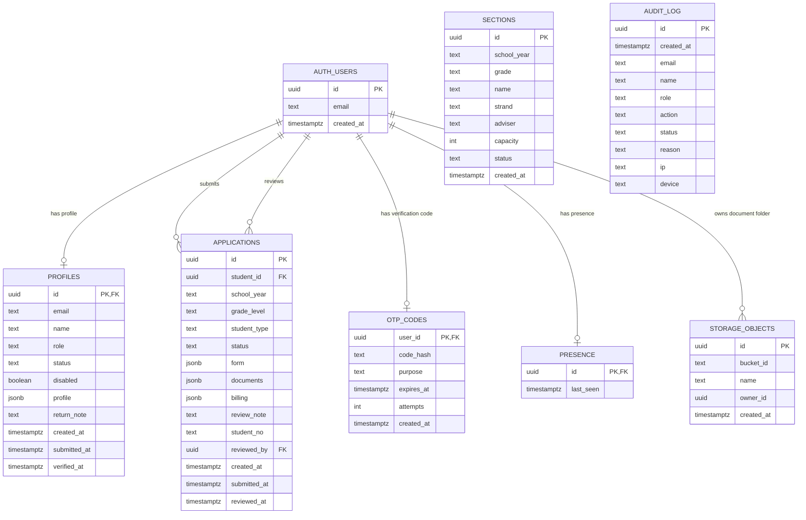

# NSDGA Enrollment Entity-Relationship Diagram

This diagram represents the database structure defined by the Supabase
canonical SQL files in [`supabase/`](../supabase/). It includes
the Supabase-managed `auth.users` and `storage.objects` entities because
application records and uploaded documents depend on them.

## Relationship notes

- `profiles.id`, `applications.student_id`, `applications.reviewed_by`,
  `otp_codes.user_id`, and `presence.id` reference `auth.users.id`.
- `applications.reviewed_by` is nullable: an application may not have been
  reviewed yet.
- `sections` currently has no database foreign key to `applications`.
  A student's section assignment is stored in the application's `form` JSONB
  data.
- Uploaded student documents are stored in the private `student-docs` bucket.
  The first path segment of `storage.objects.name` is the student's
  `auth.users.id`; this is an RLS-enforced ownership convention, not a
  database foreign key.
- `audit_log` intentionally has no user foreign key. It preserves login and
  security events even when the related account is later removed.
- `profiles.profile`, `applications.form`, `applications.documents`, and
  `applications.billing` are JSONB fields whose internal keys are application
  data rather than separate relational entities.

## Table sources

| Entity | Migration/source |
| --- | --- |
| `profiles`, `audit_log` | [`schema.sql`](../supabase/schema.sql) |
| `applications`, `billing`, `otp_codes` | [`students.sql`](../supabase/students.sql) |
| `sections` | [`sections.sql`](../supabase/sections.sql) |
| `presence` | [`presence.sql`](../supabase/presence.sql) |
| Application lifecycle and SQL setup order | [`SUPABASE-SQL-ORDER.md`](../SUPABASE-SQL-ORDER.md) |
