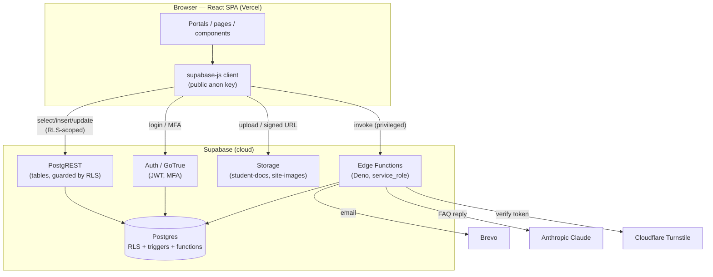
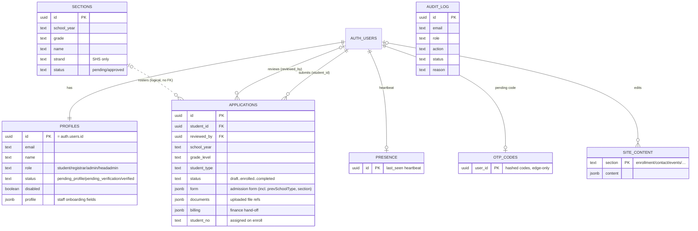

# NSDGA Online Enrollment — Technical Report

> A full, teaching-oriented walkthrough of how the system works, **frontend to backend**.
> Written to be read end-to-end so a developer can understand every moving part.
> Every claim is tied to a real file; paths look like `src/lib/student.js`.
> **Last updated:** 2026-10-14.

## Table of contents
1. [System overview](#1-system-overview)
2. [Technology stack (and why)](#2-technology-stack-and-why)
3. [High-level architecture](#3-high-level-architecture)
4. [Project structure](#4-project-structure)
5. [Data model — tables, relationships, ERD](#5-data-model--tables-relationships-erd)
6. [Row-Level Security & database triggers](#6-row-level-security--database-triggers)
7. [Authentication, session & MFA](#7-authentication-session--mfa)
8. [Authorization — the student ↔ staff boundary](#8-authorization--the-student--staff-boundary)
9. [Edge Functions (server-side logic)](#9-edge-functions-server-side-logic)
10. [Storage (document uploads)](#10-storage-document-uploads)
11. [External integrations](#11-external-integrations)
12. [The four portals — features per role](#12-the-four-portals--features-per-role)
13. [Key workflows, end to end](#13-key-workflows-end-to-end)
14. [Security posture](#14-security-posture)
15. [Testing & QA](#15-testing--qa)
16. [Deployment & operations](#16-deployment--operations)
17. [Appendix A — backend-call inventory](#appendix-a--backend-call-inventory)
18. [Appendix B — environment variables & secrets](#appendix-b--environment-variables--secrets)
19. [Appendix C — glossary](#appendix-c--glossary)

---

## 1. System overview

The system is an **online admission & enrollment portal** for Nuestra Señora de Guia Academy of Marikina (NSDGA). It lets applicants apply online, lets school staff review and enroll them, and lets administrators run the public website and school settings — all in one web app backed by a managed cloud database.

**Four roles**, each with its own portal:

| Role | Who | What they do |
|---|---|---|
| **Student / Applicant** | the learner (or parent) | Apply online, upload documents, track status; once enrolled, view their record, section, and classmates |
| **Registrar** | admissions staff | Review applications, verify documents, enroll/return/reject, build sections, manage the student lifecycle |
| **Admin** | website/content staff | Manage the public website content, the active school year, section approvals, finance export, and student-account recovery |
| **HeadAdmin** | the school's top admin | Create/verify staff accounts, change roles, read the audit log and reports |

**The core lifecycle** the whole system revolves around:

```
Applicant applies → Registrar reviews → (corrections?) → Enrolled (gets Student No.)
→ Admin approves the class section → Student sees their section + classmates
```

Everything else (accounts, documents, website content, finance hand-off, security) supports that spine.

---

## 2. Technology stack (and why)

| Layer | Technology | Why it's used |
|---|---|---|
| **UI framework** | React 19 + Vite | Component-based SPA; Vite gives a fast dev server + optimized build |
| **Routing** | React Router 7 (lazy routes) | Per-portal routes, code-split so each page loads on demand |
| **Styling** | Tailwind CSS v4 + daisyUI | Utility-first styling; consistent design without hand-written CSS |
| **Icons** | react-icons | Icon set used across the portals |
| **Backend (BaaS)** | **Supabase** | Postgres database + Auth + Storage + Edge Functions in one managed service — no custom server to run |
| **Database** | Postgres + **Row-Level Security (RLS)** | RLS is the real security boundary — each row's access is decided in the DB, not the UI |
| **Auth** | Supabase Auth (GoTrue) | Email/password login, JWT sessions, TOTP MFA; plus a custom email-OTP layer |
| **Serverless** | Supabase Edge Functions (Deno/TypeScript) | Privileged operations that must run server-side (create users, send email, call paid APIs, verify OTP) |
| **Email** | Brevo | Sends OTP codes and applicant notifications (300/day free tier) |
| **AI chatbot** | Anthropic Claude (Haiku) | A grounded admission-FAQ assistant on the public pages |
| **Bot protection** | Cloudflare Turnstile | CAPTCHA on the public signup endpoint |
| **Address data** | PSGC dataset | Region → Province → City → Barangay cascading dropdowns |
| **Hosting** | Vercel | Hosts the React build; **auto-deploys on every `git push` to `main`** |

**The key mental model:** the browser only ever holds the **public anon key**. It can talk to the database directly (`supabase-js`), but **RLS decides what it's allowed to see or change**. Anything that needs real power (the `service_role` key, the Anthropic/Brevo keys) lives **only inside Edge Functions**, never in the browser.

---

## 3. High-level architecture



**How a normal request flows (e.g. a student viewing their application):**
1. React calls `supabase.from('applications').select('*')` with the user's JWT.
2. PostgREST runs the query, but the RLS policy rewrites it to `... where student_id = auth.uid()` — so the student only ever gets their own rows.
3. The data returns to React and renders.

**How a privileged request flows (e.g. HeadAdmin creating a registrar):**
1. React calls `supabase.functions.invoke('create-staff', { body })`.
2. The Edge Function checks the caller's JWT (must be a HeadAdmin with MFA), then uses the **service_role** key to create the user — something the browser can never do directly.

---

## 4. Project structure

```
src/
├── App.jsx                     # all routes + ProtectedRoute guards
├── lib/
│   ├── supabase.js             # the single supabase-js client (anon key)
│   ├── student.js              # applicant/student data layer
│   ├── registrar.js            # registrar/admin operations
│   ├── content.js              # public website content (site_content)
│   ├── billing.js              # finance export (CSV)
│   ├── print.js                # printable class lists (escaped HTML)
│   ├── grades.js               # grade levels, strands, next-grade logic
│   ├── phAddress.js            # PSGC address lookups
│   └── password.js             # shared password policy
├── auth/
│   ├── authStore.js            # auth, staff mgmt, audit logging, MFA
│   └── LoginForm.jsx           # shared staff login
├── contexts/
│   ├── SessionProvider.jsx     # loads session + profile, exposes useSession
│   └── useSession.js
└── components/
    ├── pages/
    │   ├── StudentPortal/      # Apply, Dashboard, EnrollmentForm, Documents, …
    │   ├── RegistrarPortal/    # Dashboard, Applications, ApplicationDetails, …
    │   ├── AdminPortal/        # Dashboard, EditEnrollment, SectionApprovals, …
    │   └── HeadAdminPortal/    # Accounts, AuditLog, Reports, SystemUsage, …
    ├── ChatbotWidget.jsx       # applicant FAQ bot
    ├── AddressPicker.jsx       # cascading address dropdowns
    ├── MyActivity.jsx          # shared "my activity" feed
    └── …

supabase/
├── schema.sql, students.sql, signup.sql, sections*.sql, billing.sql, …   # the DB schema (run in order)
├── harden-*.sql                # security hardening migrations
└── functions/                  # Edge Functions (one folder each)
    ├── create-applicant/  create-staff/  chatbot/  notify/
    ├── send-otp/  verify-otp/  send-reset-otp/  reset-password/
    └── admin-role-change/  admin-set-password/  admin-remove-mfa/  admin-account-limits/

tests/security/rls.test.mjs     # reusable RLS probe
```

**Data-layer convention:** React components never build raw queries. They call functions in `src/lib/*` and `src/auth/authStore.js`, which wrap the Supabase calls. This keeps the backend contract in one place.

---

## 5. Data model — tables, relationships, ERD

Everything hangs off Supabase's built-in `auth.users` table. Application data lives in the `public` schema. **Semi-structured data is stored as `jsonb`** (the `form`, `documents`, `billing`, `profile`, and `content` columns), so the admission form can change without a database migration per field.



**Table purposes:**

| Table | Purpose |
|---|---|
| `profiles` | One row per account: role, verification status, and (for staff) the onboarding profile. A student row is auto-created on signup. |
| `applications` | One admission/enrollment record **per applicant per school year**. One person can have *many* over the years — that's how re-enrollment keeps a full history under one Student Number. |
| `sections` | Class sections per grade per year (strand-specific for SHS). Registrar creates them, Admin approves them. |
| `audit_log` | Append-only trail of logins, MFA failures, and every staff/student action. Writes go through the `log_event()` function. |
| `otp_codes` | Hashed one-time email codes (signup / password reset / admin step-up). Reachable only by Edge Functions. |
| `presence` | Per-user "last seen" heartbeat so staff can see who's online. |
| `site_content` | Public website content + the **active school year** and **account limits**, one `jsonb` row per section. |
| `chat_rate_limits` | Per-IP counter that throttles the chatbot. Edge-only. |

**Where the student's "section + classmates" live:** not in a join table — they're written into `applications.form` (`section`, `sectionApproved`, `classmates`) **when the Admin approves the section**. That way a student reads their class from their *own* row and never needs read access to other students' data (see §8).

---

## 6. Row-Level Security & database triggers

RLS is enabled on **every** table. These policies are the actual security — the UI guards (§8) are only convenience.

| Table | SELECT | INSERT | UPDATE | DELETE |
|---|---|---|---|---|
| `profiles` | self or HeadAdmin | HeadAdmin only | self or HeadAdmin* | — |
| `applications` | own or staff | own (`student_id = auth.uid()`) | own or staff* | — |
| `sections` | staff | staff | staff | staff |
| `audit_log` | HeadAdmin or self | **none** (via `log_event()` only) | — | — |
| `otp_codes` | none (service-role only) | — | — | — |
| `presence` | self or staff | self | self | — |
| `site_content` | public | admin/headadmin | admin/headadmin | — |

\* RLS lets the row through, then a **trigger** enforces the rules a policy can't express:

- **`enforce_profile_update`** — a non-HeadAdmin may edit their own profile data but **cannot** change `role`, `status`, or `disabled`. This is what makes privilege escalation impossible.
- **`enforce_application_update`** — a student may edit their form, but **cannot** change their application `status` (except `needs_correction → submitted`), set their own `student_no`, or touch `billing`. Also enforces a **60-second resubmit throttle**.
- **`enforce_application_insert`** — a non-staff insert can only create a `draft`/`submitted` row (no elevated status, no student number).
- **`handle_new_user`** — fires when any auth user is created; **always forces `role = 'student'`** (the display name comes from metadata, the role never does). This closes the self-signup escalation hole.
- **`enforce_section_limit`** / **`enforce_account_limit`** — cap how many sections per grade and active accounts per role can exist.

**SECURITY DEFINER helper functions** (run with elevated rights, used inside policies to avoid recursion): `is_staff()`, `is_headadmin()`, `is_admin_or_head()`. Plus `log_event()` (the only audit writer — stamps identity from the JWT), `chat_rate_check()` (rate limiter), and `remove_user_mfa()` (service-role only).

---

## 7. Authentication, session & MFA

**Login** (`src/auth/authStore.js`, `src/lib/student.js`):
- `supabase.auth.signInWithPassword(...)` returns a JWT session, stored by supabase-js in `localStorage`.
- Students log in via `signInStudent()` (rejects non-students, blocks disabled/deprovisioned accounts, records the login in the audit log).
- Staff log in via the shared `LoginForm` + `signIn()`.

**Session state** (`src/contexts/SessionProvider.jsx`):
- On load (and on every auth change), it fetches the user's `profiles` row and builds a session object: `{ id, email, name, role, profile, isEnrolled, … }` plus MFA status (`getAuthenticatorAssuranceLevel`, `listFactors`).
- Components read it via `useSession()`.
- It also sends a periodic **presence** heartbeat.

**Route protection** (`src/App.jsx` → `ProtectedRoute`):
- Props: `allow={[roles]}`, `requireVerified`, `requireEnrolled`.
- A logged-out user or a wrong-role user is redirected to the right login / their own dashboard. *This is a UI convenience — the database (RLS) is what actually protects the data.*

**Multi-Factor Authentication (TOTP):**
- `enrollMfa()` → `activateMfa()` set up an authenticator; `challenge()`/`verify()` check codes (`authStore.js`).
- `MfaLock` / `useMfaLock` gate sensitive staff actions until MFA is enabled.
- Failed MFA attempts are logged (`MFA_FAIL`) and surfaced to the HeadAdmin as a brute-force alert (`mfaAlerts()`).

**Custom email OTP** (separate from TOTP) — used in three places, all via Edge Functions that store a **hashed** code in `otp_codes`:
1. **Signup verification** — `send-otp` / `verify-otp` flips a draft application to `submitted`.
2. **Password reset** — `send-reset-otp` / `reset-password`.
3. **Admin step-up** — `admin-role-change`, `admin-set-password`, `admin-remove-mfa`, `admin-account-limits` email a code to the acting admin before applying a sensitive change.

---

## 8. Authorization — the student ↔ staff boundary

This is the most important boundary. It is enforced **server-side**, in three layers:

1. **RLS policies** — a student's query is physically rewritten to their own rows. Changing an ID in a request returns nothing.
2. **Triggers** — block the specific mutations a policy can't express (role/status/student-number/billing changes).
3. **Edge-function role checks** — every privileged function re-reads the caller's role from the JWT and requires MFA/OTP.

Why the design is safe by construction:
- A student **can't read another student's application** — the SELECT policy filters by `auth.uid()`.
- A student **can't escalate** — `enforce_profile_update` rejects any `role` change; `handle_new_user` forces new signups to `student`.
- A student **can't self-enroll** — `enforce_application_update/insert` reject status/student-number changes.
- A registrar **can't read all profiles** (no user enumeration) — the `profiles` SELECT policy is self-or-HeadAdmin.
- The **section/classmate list** is pushed into each student's own row on approval, so students never need read access to anyone else's data.

*(All of the above is proven by the live probe in `tests/security/rls.test.mjs` — see §15.)*

---

## 9. Edge Functions (server-side logic)

Edge Functions run on Supabase (Deno/TypeScript) with the **service_role** key, so they can do what the browser can't. Each checks auth before acting.

| Function | Caller | What it does | Protections |
|---|---|---|---|
| `create-applicant` | **public** | Creates a `student` account + a draft application, atomically | Cloudflare Turnstile (fail-closed) + server-side format validation (phone/LRN/Gmail/password) |
| `create-staff` | HeadAdmin | Creates a `registrar`/`admin` account | Requires HeadAdmin role **+ MFA** |
| `chatbot` | **public** | Proxies a grounded FAQ to Claude Haiku | Per-IP rate limit (20/60s); message/size caps; never sees student records |
| `notify` | staff | Emails an applicant (via Brevo) | Rejects non-staff |
| `send-otp` / `verify-otp` | applicant | Signup email verification | Hashed code, 10-min expiry, attempt cap |
| `send-reset-otp` / `reset-password` | public (by email) | Password reset via emailed code | Hashed code, throttled |
| `admin-role-change` | HeadAdmin | Change a staff member's role | Role + MFA + **emailed OTP step-up** |
| `admin-set-password` | HeadAdmin→staff, Admin→student | Reset a password | Role + MFA + OTP |
| `admin-remove-mfa` | HeadAdmin→staff, Admin→student | Account recovery (clear MFA) | Role + MFA + OTP |
| `admin-account-limits` | HeadAdmin | Change per-role active-account caps | Role + MFA + OTP |

All functions set `CORS: *` (they're APIs; auth is via JWT/role checks, not CORS). Secrets (`SUPABASE_SERVICE_ROLE_KEY`, `ANTHROPIC_API_KEY`, `BREVO_API_KEY`, `TURNSTILE_SECRET`) are read from the function environment — never shipped to the browser.

---

## 10. Storage (document uploads)

- **`student-docs`** — a **private** bucket. Files live under a per-user folder: `{user_id}/{docKey}.{ext}`.
  - A student can upload/replace **only their own folder**; staff can read all; nobody can read another student's folder.
  - Files are viewed via **short-lived signed URLs** (`createSignedUrl`, 5 min) — `signedDocUrl()` in `src/lib/student.js`.
  - Bucket limit: 5 MB, jpg/png/pdf only. Uploads use a **stable path + upsert**, so re-uploads overwrite instead of piling up.
- **`site-images`** — a **public** bucket for website images (events, board photos), written by the Admin via `src/lib/content.js`.

Required applicant documents: **2x2 Picture, Report Card (Form 138), PSA Birth Certificate, Good Moral Certificate**. *(Form 137 is transmitted school-to-school and is never uploaded by the applicant.)*

---

## 11. External integrations

| Service | Where | Purpose |
|---|---|---|
| **Brevo** | `notify`, `send-otp`, `send-reset-otp`, admin-* | Transactional email (OTP codes, applicant notifications). Free tier 300/day. |
| **Anthropic Claude (Haiku)** | `chatbot` | The admission-FAQ assistant. Given only the school's facts + a short non-sensitive page context; never reads records. |
| **Cloudflare Turnstile** | `create-applicant` | CAPTCHA that stops bots from mass-creating accounts. Fails closed if its secret isn't set. |
| **PSGC address data** | `src/lib/phAddress.js`, `AddressPicker.jsx` | Region → Province → City → Barangay dropdowns. |
| **Vercel** | hosting | Serves the React build; auto-deploys on `git push` to `main`. |

---

## 12. The four portals — features per role

**Student / Applicant** (`src/components/pages/StudentPortal/`)
- **Apply** (7-step wizard): account → personal info → grade & type → academic background (incl. Public/Private previous school) → create account (email + password + CAPTCHA) → upload documents → review & submit (OTP-confirmed).
- **Dashboard** — status, student number, admission progress, announcements, re-upload alerts.
- **Enrollment Form** — editable when returned for corrections (unlimited resubmits, throttled server-side).
- **Documents** — upload / re-upload, see per-document status.
- **Notifications**, **My Activity**, **Profile**, **Settings** (password + MFA).

**Registrar** (`src/components/pages/RegistrarPortal/`)
- **Dashboard** — counts scoped to the Admin's active year + newest applications.
- **Applications** / **Application Details** — review the form + documents, verify/reject each document, mark under review, return for correction, reject, or **Approve & Enroll** (assigns a Student Number).
- **Documents** — triage by completeness.
- **Student Records / Student Profile** — full per-student history + lifecycle (complete year, graduate, withdraw, archive, reactivate, re-admit) + bulk archive.
- **Sections** — create/rename/delete, assign students (manual + auto-fill), submit for Admin approval.
- **History** — the registrar's own activity feed.

**Admin** (`src/components/pages/AdminPortal/`)
- **Website content**: Enrollment & Announcements (incl. **active school year** + section caps), Contact Info, School Events, Executive Board, Academic Schedule, SHS Courses.
- **Section Approvals** — approve the registrar's sections (releases each student's section + classmates), print class/master lists.
- **Finance Export** — read-only CSV of the active year's enrolled list (with Public/Private filter) for the Finance office.
- **Manage Student** — recover a student's account (reset password / remove MFA, OTP-confirmed).
- **My Activity**, **Profile**, **Settings**.

**HeadAdmin** (`src/components/pages/HeadAdminPortal/`)
- **Accounts** — create staff, verify onboarding, enable/disable, change roles (OTP), reset staff password/MFA, set per-role **account limits**.
- **Audit Log** — every login + staff/student action, filterable, with MFA brute-force alerts.
- **Reports & Analytics** — school-wide enrollment stats + CSV export.
- **System Usage** — free-tier resource gauges.

---

## 13. Key workflows, end to end

**A. Applicant signup → submission**
1. Apply wizard account step → `createApplicantAccount()` → Edge `create-applicant` (CAPTCHA + validation) creates a `student` + a **draft** application, then signs the applicant in.
2. They fill the rest of the wizard; each step saves via `saveApplicationDraft()`.
3. They upload documents → `uploadStudentDoc()` (private bucket).
4. Review & submit → `send-otp` emails a code → `verify-otp` flips the application to **submitted**.

**B. Registrar review → enrollment**
1. Registrar opens the application (`ApplicationDetails`), reads the form + opens documents via signed URLs.
2. Per document: **Verify / Reject** (`setDocumentStatus`).
3. Decision: **Mark Under Review** / **Return for Correction** (with a note) / **Reject** / **Approve & Enroll**.
4. `enrollApplication()` assigns the next `student_no`, sets status `enrolled`, and the applicant becomes a full student. A **concurrency guard** (status-checked updates) stops two registrars from double-handling one applicant.

**C. Sectioning → classmates visible**
1. Registrar creates sections and assigns students (`Sections`).
2. Registrar submits a section for approval.
3. Admin **approves** it (`SectionApprovals`) → `approveSection()` writes each student's `section` + `classmates` into **their own `applications.form`**.
4. Students now see their section/classmates on their dashboard — without any cross-student read access.

**D. Staff onboarding**
1. HeadAdmin creates the account (`create-staff`, role = registrar/admin, status `pending_profile`).
2. The new staff logs in and completes **ProfileSetup** → status `pending_verification`.
3. HeadAdmin **verifies** → status `verified` → full portal access.

**E. Finance hand-off**
- Admin opens **Finance Export**, filters the active year's enrolled list (optionally by Public/Private school origin), and downloads a CSV. The school's Finance office does assessment/collection in their own system — this app never stores payments.

---

## 14. Security posture

A full security review was done and every finding fixed — see **`security-report.md`** (findings F-01…F-11) and **`QA-REPORT.md`**. Summary of what protects the system:

- **Secrets:** only the public anon key ships to the browser; `service_role` + API keys are server-side only (verified absent from the bundle and git history).
- **RLS on every table**; students read/modify only their own rows (IDOR blocked).
- **No privilege escalation:** signups are forced to `student`; role/status/student-number changes are trigger-blocked.
- **Strong staff-action gating:** role + MFA + emailed OTP step-up on account changes.
- **Audit integrity:** writes only via `log_event()` (identity from the JWT); direct inserts revoked.
- **Abuse protection:** CAPTCHA (fail-closed) on signup; per-IP rate limit on the chatbot; server-side input validation on the public endpoint.
- **Private documents** with per-user folders + signed URLs.
- **No XSS sinks**; the one HTML-generating path (print) escapes all values.

---

## 15. Testing & QA

A 5-phase QA + security engagement was performed (recon → functional → backend/API → security → report), captured in **`QA-REPORT.md`**.

- **Functional (Phase 2):** route protection + session — **8/8 pass** (logged-out and students are blocked from staff portals; logout fully clears the session).
- **Backend/API (Phase 3):** a reusable direct-API probe, **`tests/security/rls.test.mjs`**, asserts the student↔staff boundary **as real users** — **18/18 pass** (IDOR blocked, escalation blocked, anon reads nothing, staff access correct). Re-run anytime:
  ```bash
  node tests/security/rls.test.mjs
  ```
- **Edge-function auth:** all privileged functions reject anonymous calls — **6/6**.

Manual test material also lives in `MANUAL-TEST-CHECKLIST.md` and the `NSDGA-Test-Cases*.csv` files.

---

## 16. Deployment & operations

**Frontend** — hosted on **Vercel**, which **auto-deploys on every `git push` to `main`**. No manual step.

**Backend** — the operator applies these **by hand** in the Supabase dashboard (they are not auto-deployed):
- **SQL** files in `supabase/*.sql` — run in the SQL Editor (schema + the `harden-*.sql` migrations).
- **Edge Functions** in `supabase/functions/*` — deployed via the dashboard or `supabase functions deploy <name>`.
- **Secrets** (Edge Functions → Secrets): `ANTHROPIC_API_KEY`, `BREVO_API_KEY`, `NOTIFY_FROM_EMAIL`, `NOTIFY_FROM_NAME`, `TURNSTILE_SECRET`.

**Go-live checklist** (before real use):
- Swap the Turnstile **test** secret for a real Cloudflare key; set an Anthropic **spend limit**.
- In Auth settings: turn **off** public self-signup (all accounts go through Edge Functions); turn **on** leaked-password protection.
- Change the demo HeadAdmin password and enable MFA; force MFA for all staff.
- Purge any demo/seed data; confirm the Security Advisor is clean.

---

## Appendix A — backend-call inventory

| Where | Type | Target | Op | Role |
|---|---|---|---|---|
| student.js / SessionProvider | Table | `applications` | select/insert/update | student(own) |
| registrar.js / billing.js | Table | `applications` | select/update | staff |
| authStore / student.js / SessionProvider | Table | `profiles` | select/update/insert | self / headadmin |
| registrar.js | Table | `sections` | CRUD | staff |
| authStore / registrar.js | Table | `audit_log` | select | headadmin/self |
| authStore (`log_event`) | RPC | `log_event` | insert | anon/auth |
| content.js / authStore | Table | `site_content` | select/upsert | public / admin |
| student.js | Storage | `student-docs` | upload / signed URL | student own / staff |
| content.js | Storage | `site-images` | upload / public URL | admin / public |
| student.js | Edge | `create-applicant`, `send-otp`, `verify-otp`, `send-reset-otp`, `reset-password` | — | applicant/anon |
| ChatbotWidget | Edge | `chatbot` | — | anon |
| authStore | Edge | `create-staff`, `admin-role-change`, `admin-set-password`, `admin-remove-mfa`, `admin-account-limits` | — | headadmin/admin |
| registrar.js | Edge | `notify` | — | staff |

## Appendix B — environment variables & secrets

**Client (`.env.local`, shipped to the browser — safe, public):**
- `VITE_SUPABASE_URL` — the Supabase project URL
- `VITE_SUPABASE_ANON_KEY` — the public/publishable key (RLS guards the data)

**Server (Edge Function secrets, never in the browser):**
- `SUPABASE_SERVICE_ROLE_KEY` (auto-injected) · `SUPABASE_URL` / `SUPABASE_ANON_KEY` (auto-injected)
- `ANTHROPIC_API_KEY` · `BREVO_API_KEY` · `NOTIFY_FROM_EMAIL` · `NOTIFY_FROM_NAME` · `TURNSTILE_SECRET`

## Appendix C — glossary

- **RLS (Row-Level Security)** — Postgres feature that filters which rows a query can touch, per logged-in user. The core security mechanism here.
- **anon key** — the public API key in the browser; safe to expose because RLS enforces access.
- **service_role key** — the all-powerful key; lives only in Edge Functions.
- **Edge Function** — a small serverless (Deno) function on Supabase for privileged/server-side work.
- **TOTP MFA** — time-based one-time codes from an authenticator app.
- **OTP (email)** — a one-time code emailed for signup/reset/step-up; stored hashed in `otp_codes`.
- **`jsonb`** — a Postgres column type that stores flexible JSON (used for the form/documents/content).
- **AAL2** — "assurance level 2", a session that has passed MFA.
```
