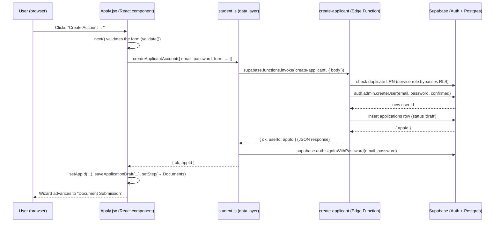
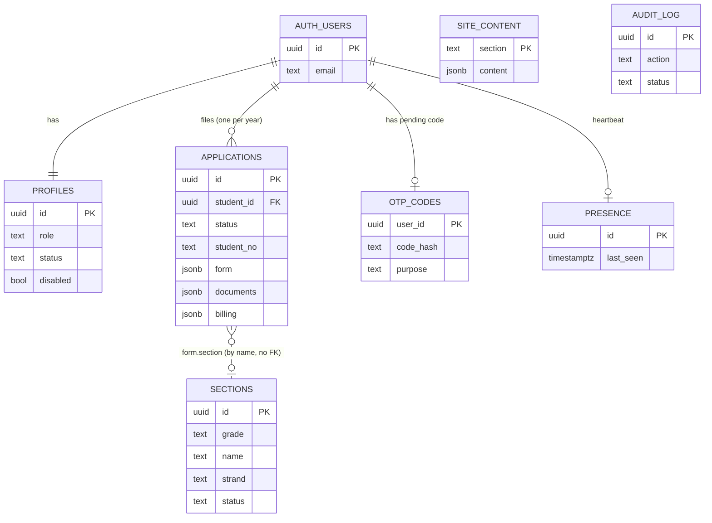

# NSDGA Enrollment Portal — Technical Report

> A teaching-oriented walkthrough of how the website works, frontend to backend.
> Every claim is tied to a real file. Read-only analysis — no code was changed.
> Where something is unclear or unverified, it is marked as such.

---

## 1. Project Overview

**What it is:** An online **admission & enrollment portal** for *Nuestra Señora de Guia Academy of Marikina (NSDGA)*. Students apply online; school staff review applications, enroll students, organize class sections, manage website content, and administer accounts.

**Who it's for (4 user roles):**
- **Student / Applicant** — applies online, tracks status, (once enrolled) uses the full student portal.
- **Registrar** — reviews applications, enrolls students, manages class sections and records.
- **Admin** — manages public website content (announcements, events, SHS courses) and payment status.
- **Head Admin** — manages staff accounts, roles, audit log, and system usage.

**Tech stack** (from [`package.json`](../package.json)):

| Technology | Role | Why it's used (one line) |
|---|---|---|
| **React 19** | UI library | Build the interface as reusable components. |
| **Vite 8** | Build tool / dev server | Fast local dev + bundles the app for production. |
| **React Router 7** | Routing | Switch "pages" in a single-page app without full reloads. |
| **Tailwind CSS v4 + daisyUI** | Styling | Style with utility classes + ready-made components. |
| **react-icons** | Icons | Consistent icon set. |
| **Supabase** (`@supabase/supabase-js`) | Backend-as-a-service | Gives us a database, login system, file storage, and serverless functions without running our own server. |
| **Vercel** | Hosting | Hosts the built frontend; auto-deploys on `git push`. |
| **Brevo** | Transactional email | Sends OTP and notification emails. |
| **Anthropic Claude (Haiku)** | AI chatbot | Answers applicant FAQs. |

> **Important mental model:** There is **no custom backend server** (no Express/Django/Node API we wrote). The "backend" is **Supabase**: a hosted PostgreSQL database with an auto-generated API, an authentication service, file storage, and small serverless **Edge Functions** (written in TypeScript/Deno) for the few operations that must run with elevated privileges.

---

## 2. Folder Structure Explained

```
NSDGA-enrollment/
├─ package.json            # Scripts + dependencies
├─ vercel.json             # Hosting config: SPA routing + security headers (CSP, etc.)
├─ index.html              # The single HTML page React mounts into
├─ .env.local             # Secrets (NOT committed): Supabase URL + anon key (names only in §10)
├─ public/
│  └─ ph-address/          # Philippine address data (region/province/city/barangay JSON)
├─ src/
│  ├─ main.jsx             # App entry: mounts <App/> inside <SessionProvider> + <BrowserRouter>
│  ├─ App.jsx              # ALL routes (URL → page component) + route guards
│  ├─ lib/                 # "Data layer" — functions that talk to Supabase
│  │  ├─ supabase.js       # Creates the single Supabase client (reads env vars)
│  │  ├─ student.js        # Student/applicant data: apply, upload docs, read status
│  │  ├─ registrar.js      # Staff review: applications, enroll, sections, records
│  │  ├─ content.js        # Public site content + SHS strands (site_content table)
│  │  ├─ grades.js         # Grade progression helpers (nextGrade, prevGrade, strands)
│  │  ├─ password.js       # One password policy (student vs staff rules)
│  │  ├─ billing.js        # Payment-status helpers
│  │  └─ phAddress.js      # Loads the PH address JSON for the address dropdowns
│  ├─ auth/
│  │  ├─ authStore.js      # Auth + account data layer (sign in, MFA, roles, audit)
│  │  └─ ProtectedRoute.jsx# Route guard: login + role + verified + MFA checks
│  ├─ contexts/
│  │  ├─ SessionProvider.jsx # Loads + holds the logged-in user's session
│  │  ├─ SessionContext.js   # The React Context object
│  │  └─ useSession.js       # Hook to read the session anywhere
│  ├─ components/
│  │  ├─ pages/            # Every screen, grouped by portal (StudentPortal, RegistrarPortal, AdminPortal, HeadAdminPortal)
│  │  ├─ AddressPicker.jsx # Region→Province→City→Barangay cascade
│  │  ├─ ChatbotWidget.jsx # Floating applicant FAQ chatbot
│  │  ├─ MfaLock.jsx       # "useMfaLock" hook — locks staff pages until MFA is on
│  │  ├─ MfaSettings.jsx   # Enable/disable authenticator (TOTP)
│  │  ├─ RemoveMfaSection.jsx # OTP-confirmed MFA reset (account recovery)
│  │  ├─ OfflineBanner.jsx # "No internet" banner
│  │  ├─ Skeleton.jsx      # Loading placeholders
│  │  └─ *Sidebar.jsx / NavBar.jsx / Header.jsx  # Navigation shells
│  └─ assets/              # Images/logos
└─ supabase/
   ├─ schema.sql           # Core tables: profiles, audit_log + triggers + RLS
   ├─ students.sql         # applications table + RLS + enforce trigger
   ├─ sections.sql (+ sections2/3/4.sql) # sections table + status/strand columns + unique index
   ├─ billing.sql          # adds a `billing` jsonb column to applications
   ├─ signup.sql           # otp_codes table (email OTP codes)
   ├─ presence.sql         # presence table (who's online)
   ├─ seed.sql             # 5 demo staff accounts
   ├─ seed-students.sql    # 100 realistic demo students (demo data only)
   ├─ indexes.sql / remove-mfa.sql / harden-production.sql / ...  # migrations + hardening
   └─ functions/           # Edge Functions (Deno/TypeScript), deployed to Supabase
      ├─ create-applicant/  # make student account + draft application
      ├─ create-staff/      # make staff account (HeadAdmin only)
      ├─ send-otp/ verify-otp/        # signup email OTP
      ├─ send-reset-otp/ reset-password/ # forgot-password email OTP
      ├─ admin-role-change/ admin-set-password/ admin-remove-mfa/ # privileged, OTP-gated
      ├─ notify/            # send a notification email to a student
      └─ chatbot/           # proxy to Claude for the applicant FAQ bot
```

> **Note (unverified):** `src/main.jsx` was not opened during this analysis, but the app clearly uses `<SessionProvider>` (see [`SessionProvider.jsx`](../src/contexts/SessionProvider.jsx)) and React Router (see [`App.jsx`](../src/App.jsx)). The exact mount wiring in `main.jsx` is assumed, not confirmed.

---

## 3. How the Frontend Talks to the Backend (The Big Picture)

### The restaurant analogy
- **You (the customer)** = the **frontend** (the React screens in the browser).
- **The waiter** = the **API** — it carries your order to the kitchen and brings food back.
- **The kitchen** = the **backend** (Supabase: database + auth + functions).
- **The pantry** = the **database** (PostgreSQL tables).
- **The order slip / the plated dish** = **JSON** — a simple text format both sides understand.

### The vocabulary
- **API** (Application Programming Interface): the agreed way the frontend asks the backend to do things.
- **HTTP request**: the message the frontend sends ("please give me this / save this").
- **HTTP response**: the message the backend sends back (the data, or an error).
- **JSON**: data written as `{ "key": "value" }` — easy for code to read/write.
- **The verbs:** **GET** = read, **POST** = create, **PUT/PATCH** = update, **DELETE** = remove.

### How THIS project does it (two paths)

Unlike a typical app, we don't call URLs by hand. We use the **Supabase client** ([`src/lib/supabase.js`](../src/lib/supabase.js)):

```js
// src/lib/supabase.js
export const supabase = createClient(url, anonKey); // url + anonKey come from .env.local
```

**Path A — Direct database calls (most reads/writes).** The client talks to Supabase's **auto-generated REST API** (PostgREST). We never write the URL; the method name says the verb:

```js
// src/lib/registrar.js  (listEnrolled) — a GET under the hood
const { data } = await supabase.from('applications')
  .select('*').eq('status', 'enrolled').order('student_no');
```
`.select()` = GET, `.insert()` = POST, `.update()` = PATCH, `.delete()` = DELETE. **Row-Level Security (RLS)** rules in the database decide which rows you're allowed to see/change (see §7), so even direct calls are safe.

**Path B — Edge Functions (privileged / server-only work).** For anything that needs the secret **service-role key** or must run on a server (creating accounts, sending email, calling Claude), we call a serverless function with `supabase.functions.invoke()` (a POST):

```js
// src/lib/student.js  (createApplicantAccount)
const { data, error } = await supabase.functions.invoke('create-applicant', {
  body: { email, password, contact, level, studentType, form },
});
```

**Authentication** is a third helper on the same client — `supabase.auth.*` (sign in, MFA, password reset) — see [`authStore.js`](../src/auth/authStore.js).

---

## 4. Request Lifecycle Diagram

Example: an applicant on the **Account Creation** step (Step 5 of the Apply wizard) clicks **"Create Account →"**.



For a **direct-DB** action (e.g., Registrar clicks **Enroll**), the shape is the same but the middle is `registrar.js → supabase.from('applications').update(...)` and RLS (not an Edge Function) authorizes it.

---

## 5. Feature-by-Feature Breakdown

### 5.1 Student sign-up + online application (the Apply wizard)
- **What the user sees:** A 7-step wizard — Account Information → Personal Information → Grade & Type → Academic Background → **Account Creation** → Document Submission → Review → Submit.
- **Frontend:** [`src/components/pages/StudentPortal/Apply.jsx`](../src/components/pages/StudentPortal/Apply.jsx). Local state via `useState` (`f` = the form, `acct` = email/password, `step`, `appId`, `docs`). Address uses [`AddressPicker.jsx`](../src/components/AddressPicker.jsx).
- **The account is created at Step 5**, not Step 1 — see `next()`:
  ```js
  // Apply.jsx → next()
  if (current === 'create' && !accountDone) {
    const res = await createApplicantAccount({ firstName, ..., email: acct.email, password: acct.password, ... });
    setAppId(res.appId);
    await saveApplicationDraft(res.appId, { form, grade_level: level, student_type: studentType });
  }
  ```
- **API request:** `POST create-applicant` with body `{ email, password, contact, level, studentType, form }`.
- **Backend:** [`supabase/functions/create-applicant/index.ts`](../supabase/functions/create-applicant/index.ts) — checks for a **duplicate LRN**, creates a confirmed auth user, inserts a **draft** `applications` row (service role bypasses RLS).
- **Database:** new row in `auth.users` + `public.profiles` (via the `handle_new_user` trigger) + `public.applications` (status `'draft'`).
- **Example response:** `{ "ok": true, "userId": "…uuid…", "appId": "…uuid…" }`
- **Submit + OTP:** On the Review step, `submit()` calls `requestSignupOtp()` → `POST send-otp` emails a 6-digit code; the applicant enters it on `VerifyOtp` → `POST verify-otp`, which flips the draft to **`submitted`** ([`verify-otp/index.ts`](../supabase/functions/verify-otp/index.ts)).

### 5.2 Document upload
- **What the user sees:** Upload boxes for 2x2 Picture, PSA, Report Card, Good Moral, (and Kinder Cert for Grade 1). **Form 137 is intentionally not uploaded** (confidential, school-to-school) — see the note in `Apply.jsx` and [`REQUIRED_DOCS` in `student.js`](../src/lib/student.js).
- **Frontend:** `onUpload()` in `Apply.jsx` → `uploadStudentDoc()` in `student.js`.
  ```js
  // student.js → uploadStudentDoc
  const path = `${user.id}/${docKey}-${Date.now()}.${ext}`;
  await supabase.storage.from('student-docs').upload(path, file, { upsert:false });
  // then record it on applications.documents (jsonb)
  ```
- **Database/Storage:** file goes into the **private** `student-docs` bucket under the student's own folder; the `applications.documents` JSON records `{ path, name, status }`. Viewing uses a short-lived **signed URL** (`signedDocUrl`, 5-minute expiry).

### 5.3 Application status tracking
- **Frontend:** [`ApplicationStatus.jsx`](../src/components/pages/StudentPortal/ApplicationStatus.jsx) → `getMyApplication()` (`student.js`) reads the signed-in student's latest `applications` row and renders the tracker (`APP_STEPS`, `STATUS_LABEL`).

### 5.4 Login (student + staff) and MFA
- **Student login:** [`Login.jsx`](../src/components/pages/StudentPortal/Login.jsx) → `signInStudent()` (`student.js`) → `supabase.auth.signInWithPassword`. Rejects non-student accounts and disabled/deprovisioned students.
- **Staff login:** `signIn()` in [`authStore.js`](../src/auth/authStore.js) with an `expectedRole` so each portal only accepts its own role.
- **MFA (TOTP):** if the account has an authenticator, login returns `mfaRequired` and the user enters a 6-digit code (`verifyMfaLogin`). Enable/disable via [`MfaSettings.jsx`](../src/components/MfaSettings.jsx) (`enrollMfa`/`activateMfa`/`disableMfa`).

### 5.5 Registrar reviews & enrolls
- **Frontend:** [`Applications.jsx`](../src/components/pages/RegistrarPortal/Applications.jsx) (list) + [`ApplicationDetails.jsx`](../src/components/pages/RegistrarPortal/ApplicationDetails.jsx) (one application).
- **Data layer:** [`registrar.js`](../src/lib/registrar.js) — `setUnderReview`, `returnForCorrection`, `rejectApplication`, `enrollApplication` (assigns a unique `student_no`), `setDocumentStatus`.
- **Database:** direct `update` on `applications` (RLS allows verified staff). Enrolling sets `status='enrolled'` + `student_no` (e.g. `2026-0001`). A `notify` email is sent via the `notify` Edge Function.

### 5.6 Class sections
- **Frontend:** [`Sections.jsx`](../src/components/pages/RegistrarPortal/Sections.jsx) (registrar creates/assigns) + [`SectionApprovals.jsx`](../src/components/pages/AdminPortal/SectionApprovals.jsx) (admin approves).
- **Data layer:** `registrar.js` — `createSection` (unique name per grade/year, 45-student cap, strand required for SHS), `assignToSection`, `submitSection`, `approveSection`.
- **Database:** `sections` table. **A student's section is stored as a string in `applications.form.section`** — there is no foreign key between `sections` and `applications` (logical link by name within the same grade + school year).

### 5.7 Admin website content & SHS courses
- **Frontend:** `AdminPortal/Edit*.jsx` pages (Enrollment, Contact, Events, Board, Schedule) + [`EditStrands.jsx`](../src/components/pages/AdminPortal/EditStrands.jsx) (SHS courses).
- **Data layer:** [`content.js`](../src/lib/content.js) — `getSection`/`saveSection` on the `site_content` table; `getStrands`/`saveStrands` for SHS courses. The Apply form reads strands live via `getStrands()`.

### 5.8 Head Admin account management
- **Frontend:** [`HeadAdminPortal/Accounts.jsx`](../src/components/pages/HeadAdminPortal/Accounts.jsx).
- **Data layer:** `authStore.js` — `createAccount` (→ `create-staff`), `updateRole`/`changeRoleWithOtp` (→ `admin-role-change`), `setUserPassword` (→ `admin-set-password`), `removeUserMfa` (→ `admin-remove-mfa`), `verifyAccount`, `setDisabled`. The sensitive ones require an emailed OTP step-up.

### 5.9 AI chatbot (applicant FAQ)
- **Frontend:** [`ChatbotWidget.jsx`](../src/components/ChatbotWidget.jsx) — floating bubble on the Apply + Application Status pages.
- **Backend:** [`chatbot/index.ts`](../supabase/functions/chatbot/index.ts) proxies to the Claude API (keeping `ANTHROPIC_API_KEY` server-side), grounded on NSDGA facts.

### 5.10 Forgot password (email OTP)
- **Frontend:** `ForgotPass.jsx` / `ForgotPassOtp.jsx` / `CreateNewPass.jsx` → `sendResetOtp`/`verifyResetOtp`/`resetPasswordWithOtp` (`student.js`).
- **Backend:** `send-reset-otp` + `reset-password` Edge Functions. *(These two function sources were not opened in this analysis; behavior is described from their callers in `student.js`.)*

---

## 6. API Endpoint Reference

### A) Edge Functions (called via `supabase.functions.invoke(name)` — a POST)

| Name | Purpose | Auth required | Request body | Example response | Defined in |
|---|---|---|---|---|---|
| `create-applicant` | Create student account + draft application; reject duplicate LRN | No (public) | `{ email, password, contact, level, studentType, form }` | `{ ok, userId, appId }` | `supabase/functions/create-applicant/index.ts` |
| `send-otp` | Email a 6-digit signup code | Yes (signed-in applicant) | `{}` | `{ ok, sentTo }` | `supabase/functions/send-otp/index.ts` |
| `verify-otp` | Verify signup code → mark application submitted | Yes | `{ code }` | `{ ok }` | `supabase/functions/verify-otp/index.ts` |
| `send-reset-otp` | Email a forgot-password code | No (by email) | `{ email }` | `{ ok }` | `supabase/functions/send-reset-otp/` *(not opened)* |
| `reset-password` | Verify reset code / set new password | No (by email+code) | `{ email, code, newPassword? }` | `{ ok }` | `supabase/functions/reset-password/` *(not opened)* |
| `create-staff` | Create registrar/admin account | Yes — **HeadAdmin + MFA** | `{ name, email, password, role }` | `{ id, email, name, role }` | `supabase/functions/create-staff/index.ts` |
| `admin-role-change` | Change a user's role (OTP step-up) | Yes — HeadAdmin + MFA | `{}` or `{ targetUserId, newRole, code }` | `{ ok }` / `{ sentTo }` | `supabase/functions/admin-role-change/` |
| `admin-set-password` | Reset a staff password (OTP) | Yes — HeadAdmin + MFA | `{}` or `{ targetUserId, newPassword, code }` | `{ ok }` / `{ sentTo }` | `supabase/functions/admin-set-password/` |
| `admin-remove-mfa` | Reset a user's MFA (OTP) | Yes — HeadAdmin→staff / Admin→student + MFA | `{}` or `{ targetUserId, code }` | `{ ok }` / `{ sentTo }` | `supabase/functions/admin-remove-mfa/index.ts` |
| `notify` | Email a student a notification | Yes (staff) | `{ studentId, subject, html }` | `{ ok }` | `supabase/functions/notify/` *(not opened)* |
| `chatbot` | Applicant FAQ via Claude | No (public) | `{ messages, context? }` | `{ reply }` | `supabase/functions/chatbot/index.ts` |

### B) Database operations (via `supabase.from(table)…` → PostgREST REST, protected by RLS)

| Table | Verbs used | Purpose | Example caller |
|---|---|---|---|
| `profiles` | select / update / insert | Account role, status, profile data | `authStore.js`, `SessionProvider.jsx` |
| `applications` | select / insert / update | Admission applications (the core record) | `student.js`, `registrar.js` |
| `sections` | select / insert / update / delete | Class sections | `registrar.js` |
| `site_content` | select / upsert | Public content + SHS strands | `content.js` |
| `otp_codes` | (service role only, in Edge Functions) | Hashed email OTP codes | `send-otp`, `verify-otp`, etc. |
| `presence` | upsert / select | "Who's online" heartbeat | `SessionProvider.jsx`, `authStore.js` |
| `audit_log` | insert / select | Login & action history | `authStore.js` |

### C) Auth & Storage (also via the Supabase client)
- **Auth:** `supabase.auth.signInWithPassword`, `.signOut`, `.updateUser`, `.resetPasswordForEmail`, `.mfa.enroll/challenge/verify/unenroll/listFactors/getAuthenticatorAssuranceLevel` — all in `authStore.js`.
- **Storage:** `student-docs` (private, admission documents) and `site-images` (public, event photos).

---

## 7. Authentication & Security

**Login:** `supabase.auth.signInWithPassword` returns a **JWT** (a signed token). The Supabase client stores it in the browser (localStorage) and **automatically attaches it to every request** — we don't manage tokens by hand. Session state is loaded and shared by [`SessionProvider.jsx`](../src/contexts/SessionProvider.jsx) and read via the `useSession()` hook.

**Protected routes:** [`ProtectedRoute.jsx`](../src/auth/ProtectedRoute.jsx) checks, in order: logged in? → owes an MFA code? → role allowed? → (if `requireEnrolled`) is the student enrolled? → (if `requireVerified`) is the account verified? → (if MFA required) is an authenticator enrolled? If a check fails, it `<Navigate>`s away. See the route table in [`App.jsx`](../src/App.jsx).

**Row-Level Security (RLS) — the real backbone.** Even though the frontend talks to the database directly, PostgreSQL policies decide what each user can touch:
- `profiles`: a user sees/edits only their own row; **only HeadAdmin** can read all rows, change roles, or enable/disable — enforced by the `is_headadmin()` helper + `enforce_profile_update` trigger ([`schema.sql`](../supabase/schema.sql)).
- `applications`: a student sees only their own; **verified staff** (`is_staff()`) see all. A student **cannot** set their own `status` to enrolled or set a `student_no` or change `billing` — blocked by `enforce_application_update` ([`students.sql`](../supabase/students.sql), [`billing.sql`](../supabase/billing.sql)).
- New sign-ups can **never** make themselves staff — `handle_new_user` forces role `student` for self-signups ([`students.sql`](../supabase/students.sql)).

**Password handling:** passwords are managed by Supabase Auth (hashed with bcrypt in `auth.users`) — the app never stores plaintext passwords. The policy lives in one place, [`password.js`](../src/lib/password.js): students need 8+ chars with a letter and number; staff need 12+ with upper/lower/number/special. The server **re-checks** the staff policy in `create-staff`.

**MFA (Two-Factor):** TOTP authenticator via Supabase `auth.mfa.*`. Staff mutation pages are gated by the `useMfaLock` hook ([`MfaLock.jsx`](../src/components/MfaLock.jsx)); privileged HeadAdmin actions are also enforced **server-side** (the Edge Functions check for a verified MFA factor). Lost authenticators are recovered via an **emailed OTP step-up** (`admin-remove-mfa`).

**OTP codes** ([`signup.sql`](../supabase/signup.sql) `otp_codes` table): stored **hashed** (SHA-256 of `userId:code`), 10-minute expiry, max 5 attempts, ~30-second resend throttle. Used for signup, password reset, and the privileged step-ups (different `purpose` values).

**CORS & headers:** Edge Functions return permissive CORS headers (`Access-Control-Allow-Origin: *`) so the browser can call them. The hosted site sends a strict **Content-Security-Policy** and other security headers via [`vercel.json`](../vercel.json) — notably `connect-src 'self' https://*.supabase.co` (the app may only talk to itself and Supabase), `frame-ancestors 'none'`, and HSTS. *(This is why the chatbot/address data must be same-origin or Supabase — an external URL would be blocked.)*

**Secrets:** the frontend only ever uses the Supabase **anon (publishable) key** (`VITE_SUPABASE_ANON_KEY`), which is safe to expose because RLS guards the data. The powerful **service-role key** lives only inside Edge Functions (`SUPABASE_SERVICE_ROLE_KEY`, auto-injected). The `ANTHROPIC_API_KEY` and `BREVO_API_KEY` also live only server-side.

---

## 8. Database & Data Models

Tables live in `public` (plus Supabase's built-in `auth.users`).

| Table | Key fields | Notes |
|---|---|---|
| `auth.users` | id, email, encrypted_password | Supabase-managed accounts. |
| `profiles` | id (→auth.users), email, name, **role**, **status**, disabled, profile(jsonb) | One per user; role ∈ student/registrar/admin/headadmin. ([`schema.sql`](../supabase/schema.sql)) |
| `applications` | id, **student_id** (→auth.users), school_year, grade_level, student_type, **status**, **form**(jsonb), **documents**(jsonb), **billing**(jsonb), student_no, review_note | The core record. One student can have many (one per school year). ([`students.sql`](../supabase/students.sql)) |
| `sections` | id, school_year, grade, name, strand, adviser, capacity, status | Class sections. Linked to students only by `form.section` string (no FK). ([`sections.sql`](../supabase/sections.sql)) |
| `site_content` | section (key), content(jsonb) | Public content + SHS strands. ([`content.js`](../src/lib/content.js)) |
| `otp_codes` | user_id (→auth.users), code_hash, purpose, expires_at, attempts | Email OTP codes (hashed). ([`signup.sql`](../supabase/signup.sql)) |
| `presence` | id (→auth.users), last_seen | "Who's online". ([`presence.sql`](../supabase/presence.sql)) |
| `audit_log` | id, email, name, role, action, status, reason, device | Login/action history (snapshots values; no FK). ([`schema.sql`](../supabase/schema.sql)) |



---

## 9. Error Handling

**Backend (Edge Functions):** return JSON like `{ "error": "message" }` (often with an HTTP status such as 400/401/429/502). Example — `verify-otp` returns `{ error: 'Incorrect code. Please try again.' }` after a wrong code and increments `attempts`; after 5 it deletes the code and returns 429.

**Backend (database/RLS):** a blocked write throws a Postgres error (e.g. `Not allowed to change role`). The Supabase client surfaces it as `{ error }`.

**Frontend:** data-layer functions return `{ ok: false, error }` (see `registrar.js`, `authStore.js`) and components show the message in a red banner. Example in `Apply.jsx`: `if (!res.ok) return setError(res.error)`. Lists show loading **skeletons** ([`Skeleton.jsx`](../src/components/Skeleton.jsx)) and empty states.

**Network/offline:** [`OfflineBanner.jsx`](../src/components/OfflineBanner.jsx) shows a global banner when the browser goes offline. The chatbot widget surfaces the real server error (it digs the message out of the function's response).

**What the user sees:** a friendly inline message ("Invalid email or password.", "This LRN is already registered…", "Please upload: …") rather than a raw crash.

---

## 10. How to Run the Project

**Prerequisites:** Node.js (18+), npm, and a Supabase project.

**1. Install dependencies**
```bash
npm install
```

**2. Create `.env.local`** in the project root with (names only — never commit real values):
```
VITE_SUPABASE_URL=<your Supabase project URL>
VITE_SUPABASE_ANON_KEY=<your Supabase anon/publishable key>
```

**3. Set up the database:** in the Supabase SQL Editor, run the SQL files in `supabase/` (start with `schema.sql`, then `students.sql`, `sections.sql`, etc.).

**4. Edge Function secrets (in the Supabase dashboard → Edge Functions → Secrets):**
- `BREVO_API_KEY`, `NOTIFY_FROM_EMAIL`, `NOTIFY_FROM_NAME` — for email.
- `ANTHROPIC_API_KEY` — for the chatbot.
- (`SUPABASE_URL`, `SUPABASE_ANON_KEY`, `SUPABASE_SERVICE_ROLE_KEY` are injected automatically.)
- Deploy the functions in `supabase/functions/` (dashboard editor or `supabase functions deploy <name>`).

**5. Run the dev server** (`package.json` scripts):
```bash
npm run dev       # start the local app (Vite) — usually http://localhost:5173
npm run build     # production build
npm run preview   # preview the production build
npm run lint      # run ESLint
```

> There is **no separate backend to start** — the backend is Supabase (already hosted).

---

## 11. Glossary

- **API** — the agreed way two programs talk (here: Supabase's auto REST API + our Edge Functions).
- **Endpoint** — one specific operation of an API (a function name, or a table operation).
- **HTTP request/response** — the question the browser asks and the answer it gets back.
- **JSON** — text data shaped like `{ "key": "value" }`.
- **GET / POST / PUT / PATCH / DELETE** — read / create / replace / update / remove.
- **Frontend / Backend** — the browser UI / the server-side logic + data.
- **Component** — a reusable piece of UI in React (a function returning JSX).
- **State** — data a component remembers and re-renders on (`useState`).
- **Props** — inputs passed from a parent component to a child.
- **Hook** — a React function starting with `use…` (e.g. `useState`, `useSession`).
- **Context** — React's way to share data (like the session) without passing props everywhere.
- **Route / Router** — a URL mapped to a page; the router swaps pages without reloading.
- **Supabase** — hosted backend: Postgres DB + Auth + Storage + Edge Functions.
- **PostgREST** — the tool that turns database tables into an automatic REST API.
- **RLS (Row-Level Security)** — database rules deciding which rows a user may read/write.
- **Edge Function** — a small serverless function (TypeScript/Deno) running on Supabase.
- **JWT** — a signed token proving who you are; sent with each request.
- **MFA / TOTP / OTP** — Multi-Factor Auth / time-based authenticator code / one-time passcode (here, emailed 6-digit codes).
- **Service-role key** — the powerful backend key (server-only); **anon key** — the public frontend key (safe because RLS guards data).
- **CORS** — browser rules for which sites a page may call.
- **CSP** — Content-Security-Policy; a header restricting what the page may load/connect to.
- **Bucket / signed URL** — a storage container / a temporary private download link.
- **LRN** — Learner Reference Number (a student's unique DepEd ID).
- **Strand** — a Senior High School course track (e.g., HT, IT, CP, TECHPRO).

---

## 12. Teaching Guide

### Suggested order to explain it
1. **Big picture** (§3) — the restaurant analogy; frontend vs Supabase.
2. **Folder tour** (§2) — where things live; `src/lib` = "how we talk to the backend."
3. **One full request** (§4) — trace Create Account end to end.
4. **Auth + RLS** (§7) — why direct DB calls are still safe.
5. **Data models** (§8) — the tables and the `form`/`documents` JSON columns.
6. **Feature walkthroughs** (§5) — pick login, apply, enroll.
7. **Edge Functions** (§6A) — why some actions need a server.

### Quiz (with answers)
1. **Q:** Where does the frontend get the Supabase connection? **A:** `src/lib/supabase.js`, using env vars `VITE_SUPABASE_URL` + `VITE_SUPABASE_ANON_KEY`.
2. **Q:** Is there a custom backend server we wrote? **A:** No — the backend is Supabase (DB + Auth + Storage + Edge Functions).
3. **Q:** Which two keys exist and where does each live? **A:** anon key (frontend, safe) and service-role key (Edge Functions only, powerful).
4. **Q:** What stops a student from enrolling themselves? **A:** RLS + the `enforce_application_update` trigger block setting `status='enrolled'` or a `student_no`.
5. **Q:** At which step is the student account actually created in the Apply wizard? **A:** Step 5 (Account Creation), via `create-applicant`.
6. **Q:** How are OTP codes stored? **A:** Hashed (SHA-256), with expiry + attempt limits, in `otp_codes`.
7. **Q:** How does the app know which page a role can access? **A:** `ProtectedRoute.jsx` checks the session's role/status/MFA against each route's props in `App.jsx`.
8. **Q:** Why can't the chatbot fetch data from any external URL in production? **A:** The CSP in `vercel.json` limits `connect-src` to self + Supabase.
9. **Q:** How is a student linked to a section? **A:** By the section **name** stored in `applications.form.section` (no foreign key).
10. **Q:** What verb does `supabase.from('x').select()` correspond to? **A:** GET (read).

### Hands-on exercises
1. **Trace "Create Account →":** open `Apply.jsx` `next()`, follow to `student.js` `createApplicantAccount`, then `create-applicant/index.ts`. List every table touched.
2. **Follow a login:** from `Login.jsx` → `signInStudent` (`student.js`) → where is the role checked, and where does the app decide applicant vs full portal? (Hint: `SessionProvider.jsx` `loadFrom` + `ProtectedRoute.jsx` `requireEnrolled`.)
3. **Read an RLS rule:** in `students.sql`, find the `applications` select policy and explain in one sentence who can read which rows.

---

## 13. Observations (notes only — not fixed)

1. **MFA is currently optional.** `MFA_REQUIRED_ROLES = []` in [`authStore.js`](../src/auth/authStore.js) (commented as temporarily off). Staff can use the portal without enrolling an authenticator until this is restored. *(Intentional for now per the code comment.)*
2. **Demo/seed data in the repo.** `seed.sql` (5 staff) and `seed-students.sql` (100 students, password `Student@123`, `@demo.nsdga.test` emails) are demo-only and should be purged before go-live. `harden-production.sql` and the seed files' own notes call this out.
3. **A few Edge Function sources were not opened** in this analysis (`send-reset-otp`, `reset-password`, `notify`, `admin-role-change`, `admin-set-password`). Their behavior is described from their callers; verify the source before relying on exact details.
4. **`sections` ↔ `applications` is a soft link** (by `form.section` string, not a foreign key). Renaming a section must update member records in code (`renameSection` does this) — there's no database-level guarantee.
5. **`audit_log` insert is open** to `anon, authenticated` (`with check (true)` in `schema.sql`) so failed logins can be recorded. That means the table could be written to by any client; it's read-restricted to HeadAdmin, but write-flooding is theoretically possible. *(Note only.)*
6. **Unused/legacy files may exist** (e.g. `LoginOtp.jsx`, `readmit.sql`, `lifecycle2.sql`) — routes exist for some; confirm which are live before teaching them as current behavior.
7. **The chatbot & duplicate-LRN features depend on manual deploys** (Edge Functions are deployed via the Supabase dashboard, not by `git push`) and on secrets/credits being set — if not deployed, those features return errors by design.

---

*End of report. Generated from a read-only review of the codebase; file paths and function names are cited throughout. Items marked "not opened" or "unverified" were not fully inspected and should be confirmed before being taught as fact.*
