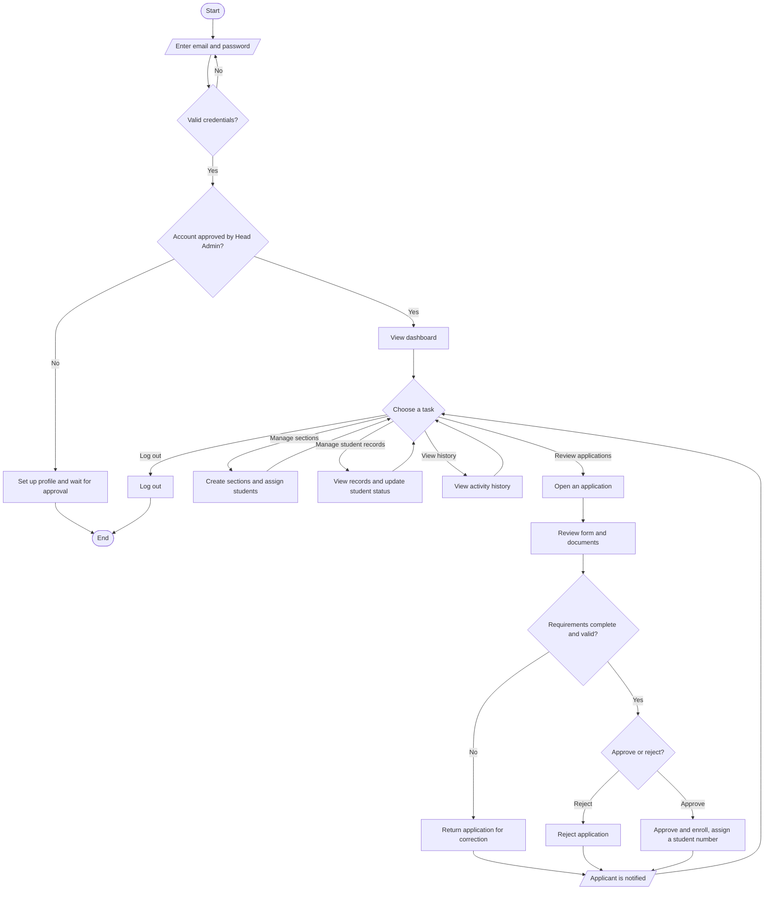

# Registrar Module — System Flowchart and Description

---

**Figure 3.1. System Flowchart of the Registrar Module**

The figure above presents the flow of the registrar module of the system developed by the researchers. The process begins when the registrar opens the system and is asked to enter a valid email and password. The system then checks whether the credentials entered are correct. If the credentials are not valid, the registrar is brought back to the login page to try again. If the credentials are valid, the system checks whether the registrar's account has already been approved by the head administrator. If the account is not yet approved, the registrar is first asked to set up a profile and to wait for approval before the system can be used. If the account is already approved, the registrar is directed to the dashboard.

From the dashboard, the registrar is able to choose a task to perform. The main task of the registrar is to review the applications submitted by the applicants. When the registrar opens an application, the system displays the applicant's form together with the uploaded documents, which the registrar reviews one by one. The system then asks whether the requirements are complete and valid. If the requirements are not complete or are not valid, the registrar returns the application for correction, and the applicant is notified so that the needed changes can be made. If the requirements are complete and valid, the registrar proceeds to decide whether to approve or reject the application.

If the registrar chooses to reject the application, the application is marked as rejected. If the registrar chooses to approve the application, the applicant is enrolled and is given a student number. In both cases, the applicant is automatically notified of the decision, and the registrar is brought back to the task selection so that another task may be performed. Aside from reviewing applications, the registrar may also create sections and assign students to them, view the student records and update the status of a student, and view a history of the actions that have already been made.

Finally, when the registrar has finished the needed tasks, the registrar may log out of the system, which ends the process. Through this flow, the proponents made sure that only approved registrars are given access to the system and that every application passes through a clear step of checking before a final decision is reached.
